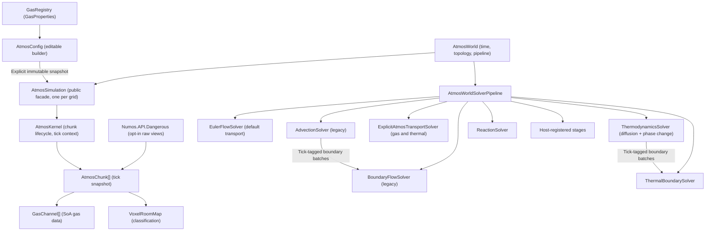

# Numos Atmospherics: Physical Model and Architecture

This is the engine-agnostic reference for how Numos stores atmospheric state, advances it each tick, and keeps the
result stable and deterministic. Pressure, thermodynamics, phase changes, and energy transfer use explicit SI units
throughout: pascals, kelvins, moles, joules, and cubic metres.

> **Revision**: 2026-10-21

---

## Contents

1. [Goals](#1-goals)
2. [How the pieces fit together](#2-how-the-pieces-fit-together)
3. [Atmospheric state](#3-atmospheric-state)
4. [One tick, start to finish](#4-one-tick-start-to-finish)
5. [Moving gas with the Euler model](#5-moving-gas-with-the-euler-model)
6. [Legacy transport](#6-legacy-transport-atmostransportmodellegacy)
7. [Heat](#7-heat)
8. [Condensation](#8-condensation)
9. [Sleep](#9-sleep)
10. [Determinism, parallelism, and precision](#10-determinism-parallelism-and-precision)
11. [Portals, docks, and explicit links](#11-portals-docks-and-explicit-links)
12. [Extending the pipeline](#12-extending-the-pipeline)
13. [Networking, replication, and recording](#13-networking-replication-and-recording)
14. [Known limitations](#14-known-limitations)
15. [Porting guidance](#15-porting-guidance)

---

## 1. Goals

Numos simulates atmospheric gas dynamics for a space-station or sealed-environment game. Its priorities are:

1. Performance with auditable units. The simulation uses the ideal-gas law `P = nRT/V` with one configurable,
   uniform voxel volume. Pressure is stored in pascals, temperature in kelvins, amount in moles, and sensible energy in
   joules. The default transport is a compressible Euler finite-volume model, inviscid and without body forces
   (§5); the older cellular pressure-relaxation model stays available as a selectable approximation (§6).
2. **Work-proportional cost.** CPU time goes to regions with active pressure gradients. Stable rooms should cost
   effectively nothing. The Euler stage makes this essential rather than nice to have: an awake chunk costs
   tens of substeps per tick whether or not anything interesting is happening in it, so sleep (§9) is what
   keeps a station affordable.
3. **Engine independence.** The core has no dependency on a game engine, rendering framework, or platform API. It is a
   standalone module driven from any engine's update loop.
4. **Multi-gas support.** Numos tracks any number of gas species with distinct physical properties. Memory is
   allocated lazily per gas, per chunk.

---

## 2. How the pieces fit together

### 2.1 Why interacting simulations share a world

`AtmosWorld` is the root of an interacting atmospheric system. It owns fixed-step time, one shared immutable physics
configuration, stable simulation registrations, the solver pipeline, and sparse topology such as portals and docks
(§11). Simulations that exchange gas or heat must agree on all of those, so they share one world.

Each `AtmosSimulation` is a separate storage domain, and every chunk has exactly one owning simulation. The
single-argument `AtmosSimulation` constructor creates a private one-simulation world for convenience; multi-grid
integrations create their simulations through a shared world.

The world runs the pipeline. Each simulation's `AtmosKernel` owns its chunk lifecycle and the tick-local solver
context. The physics lives in stage components under `Numos.CoreSim.Solvers`. A chunk (§3.1) is a fixed-size block of
voxels. Numos registers, removes, and sleeps whole chunks.

### 2.2 How the pieces connect



### 2.3 Public and Dangerous API boundaries

Numos exposes two package-level integration surfaces:

| Package | Intended use | Compatibility                        | State access                                      |
|---------|--------------|--------------------------------------|---------------------------------------------------|
| `Numos.API` | Normal engine and game integration | Supported public contract            | Handles, validated operations, detached snapshots |
| `Numos.API.Dangerous` | Measured performance-critical solver code | No compatibility guarantee (for now) | Handle-addressed live spans and unchecked state views |

Validated mutations keep pressure and heat-capacity caches, active-voxel indices, sleep state, and observable
revisions coherent. Use the dangerous package only when a solver must traverse or mutate backing storage directly.
Such a solver must also maintain those coupled invariants itself.

Reference the dangerous package separately and import `Numos.API.Dangerous`. Access begins with
`simulation.Dangerous()`. Every custom solver is registered through `simulation.World.Solvers` and receives an
`AtmosWorldSolverContext`. Most solvers use the detached snapshots and validated mutations of its simulations. A
measured hot path can instead call `simulation.Dangerous().GetChunk(handle)` from that callback. That call returns
stack-scoped live chunk and gas-channel spans. A hot path can also call `chunk.Dangerous()` on an `AtmosSolverChunk`
view from `context.Chunks(simulation)` (examples in §12.4).

The dangerous views are `ref struct` values. They never expose the internal `AtmosChunk` or `GasChannel` CLR types.
Use them inside a solver callback, because there the simulation already prevents concurrent tick and chunk-lifecycle
operations.

---

## 3. Atmospheric state

### 3.1 Chunks and voxel indexing

A chunk is a 3D grid of voxels, parameterized by `Width`, `Height`, and `Depth`. The default is 16×16×16, or 4,096
voxels; `AtmosChunkConstants.MaximumVoxelCount` caps a chunk at 65,535 so voxel indices fit in a `ushort`.

All per-voxel data is stored in flat 1D arrays indexed by:

```
index = x + (y * Width) + (z * Width * Height)
```

The inverse mapping is:

```
x = index % Width
y = (index / Width) % Height
z = index / (Width * Height)
```

Each chunk stores:

| Array               | Type           | Description                                                                                               |
|---------------------|----------------|-----------------------------------------------------------------------------------------------------------|
| `VoxelRoomMap`      | `int[]`        | Classifies each voxel (see §3.3)                                                                          |
| `TotalPressure`     | `float[]`      | Cached pressure per voxel in pascals (Pa), rewritten by the transport stage and refreshed as state changes |
| `Temperature`       | `float[]`      | Temperature in kelvins (K) per voxel                                                                      |
| `TotalHeatCapacity` | `float[]`      | Cached total heat capacity per voxel, in J/K                                                              |
| `MomentumX/Y/Z`     | `float[]`      | Total momentum of the voxel's gas per axis, in kg·m/s; zero wherever the voxel holds no gas               |
| `IsVacuum`          | `bool[]`       | Marks gasless voxels; vacuum voxels are skipped by thermal conduction                                     |
| `ActiveAirIndices`  | `ushort[]`     | Dense list of non-solid, non-void voxel indices in an awake chunk                                         |
| `ActiveGases`       | `GasChannel[]` | Sparse array of gas-specific mole data (see §3.2)                                                         |

Chunks are keyed by an `Int3 GridPosition` in a `ConcurrentDictionary<Int3, AtmosChunk>` owned by the simulation's
kernel.

**Momentum.** `MomentumX/Y/Z` hold the total momentum of everything in the voxel, not a velocity, so the velocity a
solver derives is `p / m` with `m` the voxel's gas mass from moles and molar masses. The arrays are authoritative
state: they are checkpointed, hashed, and settable through `AtmosSimulation.SetVoxelMomentum` (recorded as an external
operation). Their one invariant is that an empty voxel has zero momentum. Every path that empties a voxel (vacuum
cleanup, a solid or void classification, a mixture write that removes the last mole) zeroes them, and a momentum write
to a voxel with no gas is ignored. Adding gas leaves the stored momentum alone, which simply lowers the implied
velocity. `euler-flow` reads and writes them every tick (§5); the legacy transport stages leave them alone, so
under that model they only ever hold what the host wrote.

**Heat capacity, energy, and pressure.** A voxel's heat capacity, sensible energy, and pressure all follow from its
composition. Every gas uses an effective molar heat capacity at constant volume, falling back to a configured default
when the registry has no usable value:

```
c_fallback = isFinite(DefaultMolarHeatCapacityAtConstantVolume) && DefaultMolarHeatCapacityAtConstantVolume > 0
    ? DefaultMolarHeatCapacityAtConstantVolume
    : 5R/2
c_effective = gasIsRegistered && isFinite(MolarHeatCapacityAtConstantVolume) && MolarHeatCapacityAtConstantVolume > 0
    ? MolarHeatCapacityAtConstantVolume
    : c_fallback
C_voxel = sum(moles[g] * c_effective[g])
E_voxel = C_voxel * effectiveTemperature
P_voxel = totalMoles * R * effectiveTemperature / VoxelVolume
```

`C_voxel` is a total heat capacity in J/K, not a molar heat capacity. `E_voxel` is the sensible internal energy of the
voxel, which is why the model uses constant-volume heat capacity (`C_v`) rather than constant-pressure heat capacity
(`C_p`). `R` is the molar gas constant (`8.31446262 J/(mol·K)`, per the
[NIST reference value](https://physics.nist.gov/cgi-bin/cuu/Value?r)) and `VoxelVolume` is in m³, so `P_voxel` is in
pascals. `DefaultMolarHeatCapacityAtConstantVolume` defaults to the ideal-diatomic `5R/2` (`20.786... J/(mol·K)`).

The heat-capacity cache is updated whenever gas composition changes. When a gas-bearing voxel's stored temperature is
non-finite or nonpositive, pressure and energy calculations use `DefaultTemperatureFallback` as the effective
temperature. An invalid fallback is normalized to `293.15 K`. The next energy update stores the blended, diffused, or
phase-change temperature.

**Active air list.** Physics loops iterate the dense `ActiveAirIndices` list rather than every voxel. Waking a chunk
rebuilds the list by scanning all `VoxelCount` entries and keeping every non-solid, non-void voxel. The rebuild is
O(`VoxelCount`), or 4,096 entries for a default chunk. All later work is proportional to the active list.

### 3.2 Gas channels: one array per gas

Each gas species present in a chunk is represented by a `GasChannel`:

```
struct GasChannel {
    int GasId;
    float[] Moles;  // Length >= VoxelCount, rented from ArrayPool
}
```

- Lazy allocation. A channel is created the first time a gas is written to a chunk. A chunk containing only oxygen
  has one channel. A chunk containing oxygen, nitrogen, and plasma has three.
- ArrayPool rental. `Moles` is rented from `ArrayPool<float>.Shared`, and the first `VoxelCount` entries are cleared.
  The pool can hand back a longer array, but only the first `VoxelCount` entries are meaningful. `Release()` returns
  the array.
- Growable channel table. `ActiveGases` starts with `AtmosChunkConstants.InitialGasChannelCapacity` slots (16). It
  doubles only when another distinct gas ID reaches the chunk. Existing per-gas arrays stay where they are, so the
  structure-of-arrays layout holds for any gas IDs and counts.

### 3.3 Voxel classification

Each voxel in `VoxelRoomMap` holds an integer that determines its behavior:

| Value | Constant              | Behavior                                                                                                                                     |
|-------|-----------------------|----------------------------------------------------------------------------------------------------------------------------------------------|
| `0`   | `RoomUnassigned`      | Open, pressurizable volume. Gas can exist here.                                                                                              |
| `> 0` | *(classification ID)* | Open, pressurizable volume. IDs are retained as topology metadata and do not partition solver work.                                          |
| `-1`  | `RoomVoid`            | Infinite sink / true vacuum. Gas entering this voxel is destroyed. Used for map boundaries or active vents. Pressure is always treated as 0. |
| `-2`  | `RoomSolid`           | Solid obstruction (wall/floor). Blocks gas flow and conduction completely.                                                                   |

### 3.4 Gas properties registry

Each gas species is defined by a `GasProperties` struct:

| Field                               | Type     | Purpose                                                                                                                                                                                                                                             |
|-------------------------------------|----------|-----------------------------------------------------------------------------------------------------------------------------------------------------------------------------------------------------------------------------------------------------|
| `Name`                              | `string` | Display name, and the key application code uses to address the gas                                                                                                                                                                                  |
| `MolarHeatCapacityAtConstantVolume` | `float`  | Molar `C_v` in J/(mol·K). Controls sensible internal energy during injection, gas flow, thermal diffusion, and condensation. Missing registry entries and non-finite or nonpositive values fall back to `DefaultMolarHeatCapacityAtConstantVolume`. |
| `BoilingPoint`                      | `float`  | Normal boiling temperature (K) at `SaturationReferencePressure`                                                                                                                                                                                     |
| `CondensationEnabled`               | `bool`   | Enables this species in the condensation model                                                                                                                                                                                                      |
| `MolarEnthalpyOfVaporization`       | `float`  | Vaporization enthalpy in J/mol, used by Clausius–Clapeyron and converted to an approximate constant-volume internal-energy change for condensation                                                                                                  |
| `LiquidId`                          | `int`    | Reserved integration ID. The built-in solver does not create liquid state or emit a condensation event.                                                                                                                                             |
| `DiffusionCoefficient`              | `float`  | Effective species diffusivity `D_g` in m²/s (§5.8). Negative values clamp to zero; non-finite values disable diffusion for the species.                                                                                                     |
| `MolarMass`                         | `float`  | Molar mass in kg/mol, used to convert moles to mass for density, momentum, and sound speed. Zero, negative, and non-finite values mean unknown and normalize to zero; such a gas weighs `ReferenceMolarMass`.                                        |

The registry is a `GasRegistry` list indexed by gas ID; zero is a valid gas ID.

### 3.5 Configuration and the per-tick snapshot

Tunable parameters live on an editable `AtmosConfig`. Construction and `SetAtmosConfig(...)` capture an immutable
`AtmosConfigSnapshot`. Later edits to the builder do not change the simulation until they are applied again. This
explicit apply boundary lets recording (§13) assign each configuration change a deterministic operation sequence.

`AtmosConfigDefaults` exposes the default literals, and `AtmosPhysicalConstants` holds the immutable SI and reference
values. Fixed-step scheduling values and numerical cutoffs live in the internal `AtmosSolverConstants`. They are not
runtime configuration. `AtmosChunkConstants` holds the default chunk dimensions and initial capacities.
`VoxelClassification` defines the reserved room IDs once. Solver-owned settings, such as gas reactions, go in
`AtmosConfig.SolverConfigurations` rather than new top-level fields.

| Parameter                                  | Default | Description                                                                                                                                                                                                                                              |
|--------------------------------------------|---------|----------------------------------------------------------------------------------------------------------------------------------------------------------------------------------------------------------------------------------------------------------|
| `GlobalTemperature`                        | 293.15  | Reference temperature (K) in the species-diffusion environment factor (§5.8). Non-finite or nonpositive values normalize to 293.15 K.                                                                                                                    |
| `DefaultTemperatureFallback`               | 293.15  | Effective temperature (K) used for pressure and sensible energy when a gas-bearing voxel stores a non-finite or nonpositive temperature. Invalid values normalize to 293.15 K.                                                                           |
| `DefaultMolarHeatCapacityAtConstantVolume` | `5R/2`  | Ideal-diatomic molar `C_v` in J/(mol·K), used for missing registry entries and non-finite or nonpositive gas heat capacities. A non-finite or nonpositive fallback value is normalized to the same value.                                                |
| `VoxelVolume`                              | 1       | Physical volume represented by each voxel (m³). Its cube root is the voxel edge length `Δx` used by diffusion and by the Euler stage's face area and substep length. Invalid values normalize to 1 m³.                                                                                                              |
| `SaturationReferencePressure`              | 101325  | Pressure (Pa) at which each gas's `BoilingPoint` applies, and the reference pressure in the diffusion environment factor. Invalid values normalize to one standard atmosphere.                                                                           |
| `DefaultDiffusionCoefficient`              | 0.02    | Diffusivity in m²/s for gas IDs without a registry entry. Negative values clamp to zero; non-finite values disable fallback diffusion.                                                                                                                   |
| `SpaceTemperature`                         | 2.7     | Temperature of space (K). Not read by the built-in solvers.                                                                                                                                                                                              |
| `BulkFlowCoefficient`                      | 0.125   | Legacy model only: fraction `k` of a pressure difference requested as bulk flow per tick (§6.1). Finite values are clamped to [0, 1] and the solver further caps them at 0.5; non-finite values disable bulk flow.                                                          |
| `VacuumThreshold`                          | 1.0     | Below this pressure (Pa), voxel contents are zeroed out when every neighboring air voxel is also below the threshold. Invalid or negative values normalize to zero.                                                                                      |
| `SleepThreshold`                           | 100     | Consecutive ticks below `SleepEpsilon` before a chunk goes to sleep. Negative values normalize to zero.                                                                                                                                                  |
| `SleepEpsilon`                             | 3.5     | Maximum relative pressure difference considered "at rest" (% of the higher neighboring pressure). Invalid or negative values normalize to zero.                                                                                                          |
| `ThermalConductance`                       | 0.05    | Effective per-face conductance in J/K per thermodynamics tick. Multiplying it by a temperature difference produces a candidate energy transfer, which is bounded for explicit-solver stability. Invalid or nonpositive values disable thermal diffusion. |
| `CondensationRateFactor`                   | 0.5     | Fraction of the heat-coupled equilibrium condensation amount applied per thermodynamics tick. Finite values are clamped to [0, 1]; non-finite values disable condensation.                                                                               |
| `MaxPressureTransferFractionPerNeighbor`   | 0.16    | Clamped to [0, 1] and checkpointed, but not read by the built-in solvers. The legacy conductance limiter (§6.2) bounds outflow instead.                                                                                                                         |
| `AccumulatorWakeThreshold`                 | 15      | Pressure activity (Pa) intended to wake a sleeping chunk. Captured and checkpointed, but not read by the built-in solvers yet.                                                                                                                           |
| `AccumulatorMaxAliveTicks`                 | 20      | Lifetime in ticks of an accumulated activity value. Captured and checkpointed, but not read by the built-in solvers yet.                                                                                                                                 |
| `ReferenceMolarMass`                       | 0.02897 | Molar mass (kg/mol) assumed for gases whose `MolarMass` is unset. Defaults to dry air; non-finite or nonpositive values normalize to it.                                                                                                                 |

**Euler transport settings.** The `euler-flow` stage keeps its settings in an `EulerFlowConfig` entry (key
`euler-flow`) of `SolverConfigurations` and runs with `EulerFlowConfig.Default` when there is none. The per-tick
snapshot resolves the entry once per capture, so the stage never searches the list on the tick path. Each knob is
normalized when the configuration is captured; §5 explains the physics behind them.

| Setting                   | Default   | What it does                                                                                                                                                                                                                                                                                  |
|---------------------------|-----------|-----------------------------------------------------------------------------------------------------------------------------------------------------------------------------------------------------------------------------------------------------------------------------------------------|
| `CourantNumber`           | 0.5       | Largest fraction of a voxel a signal may cross per substep (§5.5). 0.5 is the positivity bound of the split first-order scheme: below it a substep cannot drain more gas than a voxel holds. Up to 0.8 is linearly stable with fewer substeps but can go negative next to vacuum. Clamped to (0, 1]; invalid values normalize to 0.5. |
| `MaxSubstepsPerTick`      | 64        | Cap on substeps per tick; 0 removes it. When it engages the tick advances less than 50 ms of gas time (time dilation, §5.5) and `LastFlowDiagnostics` says so. Negative values normalize to 0.                                                                                                            |
| `VelocityFloor`           | 0.005 m/s | Speed below which a voxel's momentum is zeroed at the end of the tick, its kinetic energy becoming heat (§5.7). Without it a settled room sloshes at microscopic speeds forever and never sleeps. 0 disables it.                                                                                            |
| `MaxVelocity`             | 5000 m/s  | Clamp on voxel speed, with a diagnostic counter. Expansion into vacuum tops out near 1700 m/s for room air, so the clamp only fires when a state has already gone wrong. Invalid values normalize to 5000 m/s.                                                                                              |
| `WakePressureDelta`       | 1 Pa      | Pressure difference across a chunk face that activates the inactive side (§5.6), so a 1 Pa ripple at a sealed door does not wake the whole station. 0 wakes on any difference.                                                                                                                           |
| `AllMachCorrection`       | off       | Scales the pressure-dissipation term of the face flux by the local Mach number. Godunov fluxes dissipate at the sound speed, which smears slow flow; the fix keeps it sharp but removes the acoustic damping sleep relies on and admits checkerboards, so it is off until a scene needs it.                 |
| `Reconstruction`          | `FirstOrder` | How face states are built. `MusclHancock` is reserved for second-order reconstruction and currently runs as `FirstOrder`.                                                                                                                                                                              |
| `MomentumDamping`         | 0 /s      | Exponential decay applied to every voxel's momentum per tick, `max(0, 1 − α·Δt_tick)`. A stand-in for wall friction and furniture drag so a hallway does not ring at its acoustic modes indefinitely. 0 applies none.                                                                                       |
| `DefaultLinkAreaFraction` | 1         | Open fraction of a voxel face assumed for a portal or dock that declares no area (§11.1). Clamped to [0, 1]; 0 closes such links to gas transport.                                                                                                                                                       |

- `CourantNumber` (0.5), the positivity bound of the split first-order scheme.
- `MaxSubstepsPerTick` (64). Zero removes the cap. When the cap engages, the tick advances less than a full step of gas
  time.
- `VelocityFloor` (0.005 m/s). Momentum below it is zeroed at tick end.
- `MaxVelocity` (5000 m/s), a clamp with a diagnostic counter.
- `WakePressureDelta` (1 Pa), the boundary activation threshold.
- `AllMachCorrection` (off).
- `Reconstruction` (`FirstOrder`). `MusclHancock` is reserved.
- `MomentumDamping` (0/s).
- `DefaultLinkAreaFraction` (1), the open fraction assumed for links without an area.

The per-tick snapshot resolves the entry once per capture, so the stage never searches the list on the tick path.

At the start of each tick the solver captures normalized inputs from the current `AtmosConfigSnapshot`. Built-in stages
use those values for the whole tick. Custom callbacks receive the live `AtmosSimulation`. A config applied from a
callback updates `simulation.Config` immediately, but built-in stages see it only on the next tick. Solver-originated
applications are deterministic internal work, so the recorder does not log them as external operations.

### 3.6 Container and voxel gas mixtures

`IGasMixture` gives portable containers and individual voxels one interaction model without breaking the solver's
structure-of-arrays layout:

- `AtmosSimulation.CreateGasMixture(volume, temperature)` returns a concrete `GasMixture` with independent sparse
  storage. Its `Volume` can change. It suits canisters, tanks, pipes, pumps, and temporary parcels.
- `AtmosSimulation.GetVoxelGasMixture(...)` returns an `IGasMixture` capability over one live voxel. It exposes no
  spans, gas-channel arrays, or references into pooled solver memory.
- Every mixture retains its owning `AtmosSimulation`. Transfers require both endpoints to have the same owner, so one
  applied configuration snapshot defines the gas IDs and molar heat capacities.
- `IGasMixture` is a common capability surface, not an extension point. Transfer endpoints must be mixtures created by
  `AtmosSimulation`. Numos rejects external implementations before either endpoint changes.
- A voxel capability records the chunk generation at creation. If the chunk is removed and recreated at the same
  position, the old capability becomes stale instead of retargeting to unrelated state.
- Voxel reads and mutations enter the simulation state lock. Multi-endpoint transfers capture and validate both
  results before committing, so a tick never observes a half-applied transfer.
- Solid and void voxels can be inspected but reject mutation. Disposing the owner invalidates both container and
  voxel mixtures.

Application code identifies gases by their registered names. Injection and mixture mutation reject unregistered gases.
The numeric overloads also validate registry membership. Names resolve against the owner's current configuration, while
snapshots and replay retain numeric IDs.

The common surface exposes volume, temperature, pressure, total moles, sparse gas lookup, snapshots, proportional
removal, and transfer operations. `SetMoles` and `AdjustMoles` preserve the stored temperature for low-level tooling
parity. `AddGas` and transfers instead conserve sensible internal energy, using each gas's effective constant-volume
molar heat capacity. Pressure is always derived from `P = nRT/V` and cannot be set independently.

Injecting into a voxel directly with `AtmosSimulation.AddGasToVoxel` follows the same energy rule. It recalculates the
target voxel's total heat capacity from its gas composition before temperature mixing.

Mixtures do not expose velocity. Read it with `AtmosSimulation.GetVoxelVelocity`. That call divides the voxel's stored
momentum by its current gas mass (the sum of moles times molar mass) at the moment of the call.

The `Temperature` setter stores its raw value, also for tooling parity. Pressure and sensible-energy calculations
interpret non-finite and nonpositive stored temperatures through `DefaultTemperatureFallback`. Creation and
incoming-gas operations still require finite, nonnegative temperatures.

This example assumes `"Oxygen"` has been registered:

```csharp
var canister = simulation.CreateGasMixture(volume: 0.07f, temperature: 293.15f);
canister.AddGas("Oxygen", moles: 2f, temperature: 293.15f);

IGasMixture voxel = simulation.GetVoxelGasMixture(chunk, x: 4, y: 3, z: 0);
float moved = canister.TransferTo(voxel, moles: 0.5f);
GasMixture sample = voxel.RemoveRatio(0.1f);
```

The API follows the useful container semantics of
[SS14's `GasMixture`](https://github.com/space-wizards/space-station-14/blob/master/Content.Shared/Atmos/GasMixture.cs)
while replacing its globally sized per-mixture gas array with sparse container storage and locked SoA voxel access.

---

## 4. One tick, start to finish

### 4.1 Fixed timestep accumulator

The simulation runs on a fixed timestep, decoupled from the rendering frame rate. The values live in
`AtmosSolverConstants`:

```
SimulationRate        = 20 Hz
FixedTimeStep         = 1 / SimulationRate = 0.05 s
MaximumStepsPerUpdate = 5
```

`AtmosWorld.Update(elapsedSeconds)` adds the elapsed time to an accumulator. It clamps the accumulator to
`FixedTimeStep * MaximumStepsPerUpdate`, so a frame-rate drop cannot snowball into a "spiral of death." It then runs
one world tick per whole `FixedTimeStep` the accumulator holds, up to five. `Tick()` runs exactly one.

### 4.2 The default stage order

A world tick snapshots the enabled stages, then runs each registration once with every simulation at the same tick
boundary. The default pipeline (`AtmosTransportModel.Euler`) has six stages. A host can disable, reorder, or replace each one:

| Stage                        | Work performed                                                                                                             |
|------------------------------|----------------------------------------------------------------------------------------------------------------------------|
| `euler-flow`                 | Compressible Euler transport within and across chunks, then species diffusion and vacuum cleanup (§5)                     |
| `explicit-gas-transport`     | Sparse gas transport across explicit links flagged `GasTransport` (§11)                                                    |
| `thermodynamics`             | Intra-chunk thermal diffusion and phase changes, every second tick (§7, §8)                                                |
| `explicit-thermal-transport` | Sparse thermal transport across explicit links flagged `ThermalTransport`, on the same reduced cadence as `thermodynamics` |
| `thermal-boundary`           | Cartesian thermal transport across ordinary chunk boundaries (§7.3)                                                        |
| `gas-reactions`              | Per-cell gas reactions configured through a `GasReactionConfig` in `AtmosConfig.SolverConfigurations`                      |

`euler-flow` solves the gas dynamics (species, momentum, and energy per voxel) with dimensionally split Godunov
sweeps, an HLLC flux at every face, and as many CFL substeps as the fastest signal in the simulation demands (§5).
Faces between chunks are ordinary faces of the sweep, so there is no separate boundary stage; a chunk that is asleep
or holds no gas joins the sweep when a neighbouring face needs it (§5.6). `AtmosSimulation.LastFlowDiagnostics`
reports what each tick cost (§5.7).

`AtmosTransportModel` names the two stage sets. The model is not stored on its own: it is implied by which built-in
stages the pipeline holds, and the world checkpoint records and validates that list, so a restored world runs the
model it was captured with. `new AtmosWorld(config, AtmosTransportModel.Legacy)` or
`world.Solvers.ResetToDefaults(AtmosTransportModel.Legacy)` installs the pressure-relaxation pipeline that preceded
`euler-flow`. It has seven stages: `advection` in place of `euler-flow`, `boundary-flow` added after
`explicit-gas-transport`, and the last four unchanged.

| Legacy stage                 | Work performed                                                                                                             |
|------------------------------|----------------------------------------------------------------------------------------------------------------------------|
| `advection`                  | Intra-chunk bulk flow, species diffusion, and vacuum cleanup (§6.1–§6.4)                                                   |
| `boundary-flow`              | Cartesian gas transport across ordinary chunk boundaries (§6.5)                                                            |

Gas reactions are documented at the configuration level on `GasReactionConfig`; the rest of this document covers the
other stages.

That order is what the default pipeline ships with, not a numerical requirement. Because `explicit-gas-transport` and
`explicit-thermal-transport` are ordinary stages rather than a side effect of the transport and thermodynamics
stages, a host can disable Numos' own portal/dock physics without touching Cartesian flow, and register a
replacement in its place. See [Extending portal and dock transport](#extending-portal-and-dock-transport).

A host can enable, disable, remove, or restore stages with `ResetToDefaults`. It can append custom delegates or insert
them before or after any registered stage:

```csharp
simulation.World.Solvers.Register(
    "game-reactions",
    context =>
    {
        AtmosSimulation simulation = context.Simulations[0];
        foreach (AtmosChunkHandle chunk in simulation.GetChunkHandles())
        {
            AtmosChunkSnapshot snapshot = simulation.GetChunkSnapshot(chunk);
            // Inspect the detached snapshot and apply results through validated simulation methods.
        }
    },
    after: AtmosBuiltInSolvers.EulerFlow);

simulation.World.Solvers.SetEnabled(AtmosBuiltInSolvers.Thermodynamics, false);
```

§12 covers the rest of the extension surface.

Some built-in stages hand boundary work to each other through internal tick-tagged batches: `thermodynamics`
publishes for `thermal-boundary`, and under the legacy model `advection` publishes for `boundary-flow`. That
producer/consumer link is an implementation detail, not a public stage boundary; `euler-flow` has no consumer.

### 4.3 How explicit transport fits into a tick

A world tick captures every simulation's pipeline before running any callback. It then advances every simulation
through its gas-transport barrier (`euler-flow`, or `advection` under the legacy model), applies explicit gas
transport once across the compiled world edge set, advances every simulation through thermodynamics, and applies
explicit thermal transport on the same cadence.

Explicit gas transport therefore sees the state `euler-flow` left behind: after its last substep, its diffusion
pass, and its cleanup. A link is applied once per tick from that state, outside the substep loop, which is why it
keeps the bounded duct law instead of a face flux (§11.1). The gas a link moves sits in its destination until the
next tick's sweeps pick it up.

Later stages, including custom ones, always see the completed result of both transport passes. Registration order
cannot decide which endpoint of a link updates first, because the explicit solver computes every edge's request
before committing any of them.
[Writing a custom solver that touches portals](#writing-a-custom-solver-that-touches-portals) explains why this
matters for your own solver.

### 4.4 What a stage callback can't do

Numos rejects recursive `Tick` and `Update`, simulation disposal, and chunk registration or removal during a callback,
because they would invalidate the current chunk snapshot. Do these outside the solver tick.

A callback can edit the pipeline. The edit takes effect on the next tick, because the current tick already captured
its stage list.

---

## 5. Moving gas with the Euler model

`euler-flow` is the stage that moves gas under the default transport model. It solves the compressible Euler
equations (conservation of species moles, momentum, and total energy, with no viscosity and no body forces) with a
first-order finite-volume scheme, one HLLC Riemann problem per voxel face, and as many substeps inside the 50 ms tick
as the fastest wave demands. This section is written for someone who has to maintain it; the class remarks on
`EulerFlowSolver`, `EulerSweep`, `HllcFlux`, and `EulerMixture` under `src/Numos.CoreSim/Solvers/Euler` carry the same
arguments next to the code.

### 5.1 Why pressure fractions were not enough

The legacy model (§6) moves a fixed fraction of a pressure difference per tick. That is a relaxation: the pressure
field decays toward uniform and nothing remembers which way the gas was going. It has no inertia, so it cannot
produce three things a station wants:

- A pressure wave that travels. A breach makes a front that crosses a room at the speed of sound, around 340 m/s;
  relaxation smears it out at a few voxels per tick.
- A reflection. Gas hitting a wall piles up and the pressure spike bounces back. A relaxation never overshoots, so
  nothing rebounds.
- A corridor that fills quickly. At `k = 0.125` an isolated pair loses 25% of its difference per tick, so a long
  hallway equalises over seconds of ticks rather than the fraction of a second sound takes.

Adding momentum as state is what buys all three, and once momentum is state the natural solver is a compressible one.

### 5.2 What a voxel carries

Authoritative state is unchanged apart from momentum: moles per gas `n_k`, temperature `T`, and the three momentum
components `P = (Px, Py, Pz)` (§3.1). Everything else the solver needs is rebuilt from those at the start of every
tick:

```
m = Σ n_k · M_k               mass, kg (M_k is the gas's MolarMass, or ReferenceMolarMass)
N = Σ n_k                     moles
C = Σ n_k · Cv_k              heat capacity, J/K
u = P / m                     velocity, m/s
K = ½ (Px·u + Py·v + Pz·w)    kinetic energy, J
E = C·T + K                   total energy, J (double)
p = N R T / V                 pressure, Pa
γ = (C + N R) / C             adiabatic index of the mixture
c = sqrt(γ N R T / m)         sound speed, m/s
```

The closure is the ideal gas with constant per-species `Cv`: internal energy is `C·T`, and `Cp − Cv = R` per mole
makes `γ = Cp/Cv = (C + NR)/C` for the whole mixture, so air (`Cv = 5R/2`) gives 1.4 and 343 m/s at 293 K. The sound
speed is formed as `γ·NRT/m` rather than `γ·p/ρ` because `1/m` is already computed for the velocities and the volume
drops out.

`E` is a `double`. A cubic metre of room air holds about 250 kJ of thermal energy and about 60 J of kinetic energy at
10 m/s; a `float` subtraction `E − K` would throw away the low bits of the thermal part every substep. Species,
momentum, and fluxes are `float`.

The sums over `k` run in ascending gas id over the chunk's species list. `m`, `N`, and `C` are never transported on
their own; they are re-derived from the species after every update, so mass and moles cannot drift apart.

### 5.3 Updating a cell from its faces

A voxel is a finite-volume cell. Over one substep `Δt`, each conserved quantity `U` changes by the fluxes through its
two faces along the sweep axis:

```
U_i ← U_i − Δt · A · (F_{i+½} − F_{i−½})
```

with `A = Δx²` the face area and `F` the flux per unit area, positive from the lower coordinate to the higher one.
Each face flux is evaluated once and used by both of its cells, so what leaves one cell arrives in its neighbour
exactly: moles, momentum, and energy are conserved to rounding, which the Sod and wall tests check at `1e-6` and
`1e-4` relative.

**The HLLC face flux.** The flux through a face comes from the Riemann problem between the two cell states
`(ρ, u, p)` on either side. HLLC approximates its fan as three waves (left, contact, right) and returns the flux of
whichever of the four regions sits on the face. With Davis wave speeds:

```
S_L = min(u_L − c_L, u_R − c_R)      S_R = max(u_L + c_L, u_R + c_R)
a   = ρ_L (S_L − u_L) ≤ 0            b   = ρ_R (S_R − u_R) ≥ 0
S*  = ((p_R − p_L) + (a·u_L − b·u_R)) / (a − b)
p*  = (b·p_L − a·p_R + a·b·(u_R − u_L)) / (b − a)
```

The face sees `F(U_L)` if `S_L ≥ 0`, `F(U_R)` if `S_R ≤ 0`, and otherwise the star flux adjacent to the contact's
side. Two forms are chosen on purpose. `p*` is evaluated as `½(p_L + p_R) + ½·w·(p_L − p_R) + a·b·(u_R − u_L)/(b − a)`
with `w = (a + b)/(b − a)`, which makes equal pressures give `p* == p` bitwise and `S* = ±0`, so a uniform gas at
rest feels identical pressure on both faces of each cell and never develops a round-off wind. The same `a`/`b` form is
odd under reflection (swap the cells, negate the velocities), so a mirrored tube produces the mirrored bits; the usual
shortcut `p* = p_L + a·(S* − u_L)` is only exact on one side and breaks that. The flux uses multiplies, adds, divides,
and min/max only; the one square root in the stage is the sound speed.

**Walls.** A face into a solid voxel, the edge of the grid, or a chunk that is not active this sweep (§5.6) is a
reflective wall: the Riemann problem against the cell's own mirror image. Its contact speed is exactly zero, so no
mass, energy, or tangential momentum crosses, and the only flux is the wall pressure:

```
p_wall = max(0, p + ρ·u_n·(u_n − S_L)),    S_L = −(|u_n| + c)
```

where `u_n` is the velocity toward the wall. At rest it is `p`, the same value an interior face of a uniform gas
carries. Gas running into the wall sees `p + ρ·u_n·(2u_n + c)`, the linearised reflected-shock pressure; gas pulling
away sees `p − ρ·c·|u_n|`, clamped at zero.

**Void and trace cells.** A `RoomVoid` neighbour, and any cell with no mass or fewer than `MinimumTrackedMoles`
moles, is presented to the flux as the vacuum state (all zeros). The Riemann problem against vacuum is the expansion
fan: `a = −ρc`, `b = 0`, `S* = c/γ`, `p* = 0`, and a mass flux of `ρc/(γ + 1)`. For 1 atm air that is about
172 kg/(m²·s) against the 1.2 kg a 1 m³ voxel holds, so a voxel open to space drains in roughly 8 ms, a handful of
substeps rather than the seconds the legacy 25%-per-tick law takes. Whatever crosses into a void voxel is destroyed. A
trace cell keeps the moles it has and can only receive. Vacuum never emits flux, and a face with vacuum on both sides
returns zero before any division.

**Species.** Species are not solved per face. The face records which side is upwind (the side the mass flux is drawn
from) and the weight `w = A·G_mass / m_upwind`; the cell update then moves `w · n_k,upwind` of each gas. Every
species travels in the proportion it has in the upwind cell, `Σ_k M_k·G_k = A·G_mass` holds to rounding, and mass
fractions obey a maximum principle, so no gas appears where there was none. This is the Larrouturou form of species
transport.

### 5.4 One axis at a time

Three-dimensional flow is handled by dimensional splitting: a substep is an X sweep, a Y sweep, and a Z sweep, each a
complete one-dimensional update of every cell along that axis, reading one buffer and writing the other. Splitting
keeps every face a one-dimensional Riemann problem and keeps each update local to a pencil of cells, which is what
makes the parallel schedule in §10.2 trivially deterministic.

Splitting is not symmetric: the axis swept last has slightly more say in the result, and always sweeping `X, Y, Z`
would give a blast a visible preferred direction. The sweep order therefore cycles through all six permutations,
`XYZ, ZYX, YZX, XZY, ZXY, YXZ`, indexed by `(2·TickCount + substep) mod 6`. Over any six consecutive substeps each axis
takes each position twice, so the bias averages out, and the index is a pure function of checkpointed state rather
than a counter carried across ticks, so a restored world sweeps in the same order the original run did. A corner
blast across a 2×2×2 block of chunks keeps the cube's full symmetry through the chunk faces
(`CornerBlast_InAChunkCube_KeepsTheCubeSymmetry`). An axis one voxel long with no neighbour chunk on either side is
skipped: both its faces are walls at the cell's own pressure, whose fluxes cancel exactly, so the skip changes no bit
and saves a depth-one map a third of its sweeps.

Work within a sweep is cut into pencils: an X sweep marches one `(y, z)` row, a Y sweep a whole z-slab, a Z sweep a
y-sheet. A pencil keeps a rolling pair of face rows so each face is solved once and each cell sees both of its faces
before it is written. The tangential momentum components follow the cyclic order `X → Y → Z → X`.

### 5.5 Substeps inside the tick

An explicit scheme is only stable while no wave crosses more than a cell per step, so the stage cuts the 50 ms tick
into substeps sized from the fastest signal in any active chunk:

```
λ  = max over active cells of (max(|u|, |v|, |w|) + c)
Δt = min(CourantNumber · Δx / λ, remaining)
```

`λ` is recomputed from the refreshed primitives every substep, `remaining` is accumulated in `double`, and the last
substep is whatever is left, however small, so the tick lands on exactly 50 ms. Stretching the previous substep to
absorb the remainder would run it above the Courant number, and that margin is what a face next to vacuum lives on.
Room air at 293 K (`c = 343 m/s`, `Δx = 1 m`) gives 1.46 ms substeps and about 35 per tick; air at 1000 K needs
about 65, and a vacuum front from hot, light gas can need hundreds.

**Why 0.5.** For the split first-order scheme with the `max(|u| + c)` speed definition, `CourantNumber ≤ 0.5` is the
positivity bound: each updated cell is a convex combination of the cells feeding it, so a substep can never drain
more gas from a cell than it holds. Values up to 0.8 are linearly stable and save substeps, but a face next to vacuum
can then produce a negative density that the solver has to repair (and counts in the diagnostics), which is why 0.5
is the default and 0.8 an opt-in.

**The cap.** `MaxSubstepsPerTick` (64 by default, 0 for none) stops the loop early. Stability is unaffected, since the
scheme has no time history, but the tick then advances less than 50 ms of gas time while thermodynamics, reactions,
and everything else still advance a full tick: the flow slows down relative to the rest of the world. That is time
dilation, and `AtmosFlowDiagnostics.SubstepCapEngaged` and `SimulatedSeconds` report it. One `Δt` is global per
simulation, so one hot or light gas anywhere dilates every active chunk; local time stepping per connected region is
future work (§14).

**Worked example.** A 10 m room with its left half 1% over pressure: the step launches a wave that crosses the room
in about 30 ms, reflects, and rings. The HLLC flux dissipates at the acoustic scale, so at Courant 0.5 the fundamental
mode decays with an e-folding time of roughly 0.1 s; after 1 s the largest speed is below 1 cm/s and the largest
pressure deviation below 0.1%, and the velocity floor and sleep metric (§9) then put the chunk to sleep
(`SmallPressureStep_SettlesWithinASecondAndSleeps`).

### 5.6 Chunk faces and activation

A face between two chunks is an ordinary face of the sweep; there is no boundary stage and no reserve-and-merge pass.
Both chunks solve the shared face, redundantly, from identical inputs: each side takes its own cell from its read
buffer and the other cell from the neighbour's read buffer (the already-derived primitive state and the species rows
indexed by gas id, never the neighbour's gas channels, whose order can differ) and calls the HLLC flux with the lower
global coordinate on the left. Two evaluations of the same pure function on the same bits give the same bits, so each
chunk applies its own `F_right − F_left` and the result is exactly what the same tube would produce inside one chunk;
`TwoChunkSod_IsBitwiseTheSingleChunkTube` pins that bit for bit, diagnostics included. Every chunk advances by the
same global `Δt`, so the two sides of a face always see each other at the same gas time.

Species rows are the one piece of bookkeeping cross-chunk flow adds. Each active chunk's workspace carries a row per
gas it holds plus, before each sweep, a row for every gas an active neighbour across a face of that sweep's axis
holds, merged on the tick thread between sweeps, so a gas always has a zero-filled row waiting on the side it is
about to cross into and no worker ever creates one. A zero row adds nothing to a mixture sum (`x + 0·M` is `x`
bitwise), so a cell's totals do not depend on how many absent gases its chunk happens to list, and a chunk that holds
one gas in a world of many pays for that gas plus whatever its neighbours carry, not for the world's union. The
write-back creates a channel for a row as soon as any voxel holds a positive amount of it, however far below
`MinimumTrackedMoles`: the sweep already debited the upwind cell, which may be in the other chunk, so dropping a
sub-threshold row would destroy gas every tick a slow trace flow crosses the face
(`TraceGas_CrossingAChunkFaceIsConserved`).

**Activation.** A chunk that is asleep, or awake with no gas, has no workspace and is not swept. An open face from an
active chunk into such a chunk is a wall for that sweep. That is exact while the neighbour is at rest at the same
pressure (the wall flux is then `p`, which is also the interior flux of a resting gas, and the mass flux is zero
either way) and wrong as soon as the two sides differ, so the sweep that meets such a face requests the neighbour's
activation when the pressures differ by more than `WakePressureDelta` (1 Pa) or the active side moves normal to the
face at all. Requests are applied on the tick thread after the barrier that ends the sweep: the chunk is woken if
asleep, its face masks built, its live fields gathered (exact, because nothing has written them this tick), and it is
inserted into the active list in canonical order, swept from the next sweep on at the current substep's `Δt`. Its gas
is at rest, so its signal speed is its sound speed, which the next substep's `Δt` accounts for.

A pre-pass right after the initial gather runs the same test over every boundary face from the live `TotalPressure`
of both sides and repeats for each newly activated chunk until the set is closed. A chunk that already differs from
its neighbour at the start of the tick therefore joins before the first sweep, and a pressure staircase across
several sleeping chunks wakes all of them before any gas moves; only a front that arrives mid-tick pays the one-sweep
wall latency. The pre-pass compares live pressures rather than gathered ones so two chunks filled identically compare
exactly equal even with a zero wake delta. Activation is derived from the chunk fields and the configuration and is
never recorded; a replay reactivates the same chunks at the same sweeps.

### 5.7 Trace cells, vacuum, and the write-back

A cell with no mass or fewer than `MinimumTrackedMoles` (`0.0001 mol`) is a trace cell: its momentum is dropped, its
energy is just `C·T`, and its primitive state is the vacuum, so its neighbours see it as empty and only push gas into
it. A cell whose heat capacity or energy overflows to a non-finite value is treated the same way and counted in
`AtmosFlowDiagnostics.NonFiniteCellCount`, so one corrupt voxel cannot poison its neighbours through the flux.

After the last substep the read buffer is written back to the chunk. Momentum below `VelocityFloor` (0.005 m/s) is
zeroed first, and `MomentumDamping`, if set, scales the rest by `max(0, 1 − α·Δt_tick)`; both run before the
temperature is computed, so the kinetic energy they remove becomes heat instead of vanishing. The floor runs once per
tick rather than per substep because zeroing per substep would stall every gradient below about 2 Pa/m. The
temperature is then

```
T = (E − K) / C
```

clamped at zero: a cell whose kinetic energy exceeds its total energy after a lossy rounding is written at 0 K and
counted in `NegativeInternalEnergyCount`. Pressure goes through the same `CalculatePressureAtVoxel` the rest of the
kernel uses so `IsVacuum` and the thermodynamics stage keep agreeing with it. The cached heat capacity and total moles
are summed in channel order, not gas-id order, because that is the order every other stage uses and the caches must
match what a later refresh would produce bit for bit.

Two more repairs are counted on the way: a species update that went below zero is floored
(`NegativeMolesCount`), and a speed above `MaxVelocity` (5000 m/s) is clamped (`ClampedVelocityCount`). All four
counters are bug indicators rather than physics. Expansion into hard vacuum is bounded by `2c/(γ − 1)`, about
1700 m/s for room air, so the clamp only engages when a state has already gone wrong.

### 5.8 Mixing and cleanup after the sweeps

The sweeps move species only with the bulk flow, so two gases at equal pressure on either side of a doorway would
never mix. After the write-back the stage runs species diffusion, vacuum cleanup, and a momentum post-condition, in
that order, on the chunk fields. The legacy model (§6) runs the first two inside `advection` with the same kernels.

**Species diffusion.** Each voxel sends a fixed share of each gas to every non-solid neighbour. Both voxels of a pair
do this, so the net exchange of gas `g` between `i` and `j` is `q_g,i − q_g,j`, from the richer voxel to the poorer.
For a voxel with total pressure `P`, effective temperature `T`, and `n_g` moles of gas `g`:

```
Δx    = VoxelVolume^(1/3)                                  // voxel edge length
f_env = (T / GlobalTemperature)^(3/2) * (SaturationReferencePressure / P) / Δx²
q_g   = min(D_g * f_env * n_g * FixedTimeStep, n_g / 7)    // moles sent to each non-solid neighbor
```

This is Fick's law on the grid. The flow through a face is `D_g * (A / d) * c * Δt`. For a cube the face area over
the neighbour distance is `Δx`, and the concentration is `n_g / Δx³`, which leaves `n_g / Δx²`. A room therefore
mixes at the same physical rate whatever the voxel size.

`D_g` is the gas's `DiffusionCoefficient` (or `DefaultDiffusionCoefficient` for unregistered IDs), in m²/s. The
`T^(3/2)/P` scaling is the kinetic-theory dependence of gas diffusivity: faster in hot, thin gas, slower in cold,
dense gas. At the reference temperature and pressure with 1 m³ voxels `f_env = 1 m⁻²`, so the default
`D_g = 0.02 m²/s` sends `0.02 × 0.05 = 0.1%` of a voxel's gas to each neighbour per tick, and the `n_g/7` cap keeps
the six outgoing transfers below the inventory. That default is about a thousand times molecular diffusivity in air
and stands in for convective mixing the grid does not resolve. Tiny deposits into an air voxel are suppressed when both the existing and the transferred amount
stay below `MinimumTrackedMoles`, and the source keeps that share. Transfers into void are lost. Energy travels at the
source temperature. Diffusion carries no momentum (a swap of species at equal pressure has no bulk velocity), so the
momentum arrays are untouched.

Inside a chunk this is the legacy `SpeciesDiffusionKernel` verbatim, run on the chunk fields rather than the Euler
buffers, so a chunk at rest diffuses bit for bit what `advection` would have
(`OneChunkAtRest_DiffusesBitwiseLikeLegacy`). Across chunk faces it uses the same symmetric-face idea as the sweeps:
for every open face between two active chunks, both chunks evaluate `q_g` of *both* cells from the live fields (each
cell's own pressure, temperature, and moles, with the suppression decided from the other cell's moles), and each
applies the net to its own cell, `q_g,neighbour − q_g,own` on one side and `q_g,own − q_g,neighbour` on the other.
`fl(x − y) = −fl(y − x)`, so the two nets are exact negatives and nothing needs reconciling. Every chunk computes its
face amounts before any chunk applies them, because the cells one chunk writes are the cells its neighbour reads. A
face into a chunk that is not active exchanges nothing and does not wake it (§14); a void voxel across a chunk face
is a sink, as inside a chunk. A deposit of a gas the receiving chunk has no channel for creates the channel; the
suppression rule guarantees it is a tracked amount.

**Vacuum cleanup.** Trace amounts of gas would otherwise keep chunks awake forever as they spread out. Voxels with
`TotalPressure < VacuumThreshold` (1 Pa) have all gas zeroed, but only when every orthogonally adjacent air voxel is
also below the threshold; solid walls, void voxels, and missing chunks do not prevent cleanup. The complete pressure
field is classified before any gas is removed, so traversal order cannot turn neighbouring trace voxels into a
cascade. A low-pressure expansion front survives while it is next to pressurised gas, and an isolated region is
removed once it and all of its neighbours fall below the threshold. An emptied voxel has its momentum zeroed with the
rest of its state.

**Momentum settling.** Diffusion changes a voxel's mass and cleanup empties voxels outright, so the stage re-establishes
its two momentum invariants on the live fields afterwards: a vacuum or trace voxel carries no momentum, and a voxel
slower than `VelocityFloor` is brought to rest with its kinetic energy turned into heat, exactly as before the
write-back. On a voxel neither pass touched this repeats the earlier comparison bit for bit and changes nothing. The
sleep decision (§9) runs last and therefore scores the pressures diffusion and cleanup left behind.

### 5.9 Species contacts and the mixing pressure

Species transport is upwinded by the contact speed, so a contact between two gases smears over a few cells
numerically. Where the two gases differ only in composition, or differ in `Cv` but sit at the same temperature, the
smeared cells stay at the pressure of their neighbours to round-off: a gas with `Cv = 200 J/(mol·K)` against air,
both at `p0` and 10 m/s, holds `|p − p0|/p0 < 1e-5` over 200 substeps. Where they differ in both `Cv` and `T`, a mixed
cell does not. With `ν` the mole fraction of gas A in it:

```
p'/p − 1 = ν(1 − ν)(1/T_A − 1/T_B)(Cv_B − Cv_A) / (ν·Cv_A/T_A + (1 − ν)·Cv_B/T_B)
```

This is the exact constant-volume mixing pressure of the two parcels, the pressure change real mixing would produce,
and Numos accepts it: the mixing is physical, it just happens at the numerical rate of the contact smearing rather
than the molecular one. The first mixed cell of a hot A | cold air contact matches the formula to `1e-3`.
Second-order reconstruction will narrow the band of cells it affects (§14).

### 5.10 What the tests pin

Numbers worth knowing when something changes (`tests/Numos.CoreSim.IntegrationTests/Euler`):

- **Sod shock tube** (Toro test 1 mapped to a 1 kg/mol gas, 100 cells, five ticks): pressure and velocity in the star
  region within 0.35% of the exact Riemann solution (asserted at 2%), the two star densities within 3%, L1 density
  error under 0.03 per cell, moles conserved to `1e-6` relative and energy to `1e-4`.
- **Wall reflection**: air at Mach 0.1 into a wall gives the reflected-shock plateau `p/p0 = 1.1485` against the
  Rankine–Hugoniot value 1.1486; a 1 m/s pulse gives a rise of 414 Pa against the acoustic `ρ·c·u0 = 413 Pa`.
- **Rest and drain**: a uniform room is bitwise static with zero velocity after a tick of substeps; a tube open to
  void drains monotonically to below `MinimumTrackedMoles` with no negative moles; a trace cell next to air never more
  than doubles the substep count.
- **Chunks and workers**: the two-chunk Sod tube is bitwise equal to the one-chunk tube; mirrored data gives
  mirror-equal bits; the whole-chunk and tiled schedules agree bitwise at every worker count, and the corner-blast
  digest is pinned per architecture (x64 and arm64 differ through `TensorPrimitives`' use of fused multiply-add, the
  known split of issue #87).
- **Cost**: room air needs about 35 substeps per tick, and one dense awake 16³ chunk of it costs about 19 ms per tick
  single-threaded. That is why sleep (§9) and the parallel schedule (§10.2) are not optional with this model;
  `benchmarks/README.md` has the cases.

---

## 6. Legacy transport (`AtmosTransportModel.Legacy`)

The pressure-relaxation stages that preceded `euler-flow` remain selectable (§4.2) and unchanged. `advection` moves
gas inside each awake chunk in two passes, bulk flow down pressure gradients and then species diffusion, and finishes
with vacuum cleanup; `boundary-flow` carries the same bulk law across chunk faces. Diffusion and cleanup are the
kernels described in §5.8. The model never reads or writes momentum.

Advection is a first-order explicit cellular automaton, and those ring or blow up when a tick moves more than the
local state can absorb. The bulk-flow coefficient (§6.1) and the shared conductance limiter (§6.2) are what keep each
tick bounded.

### 6.1 How much gas a pressure difference moves

Given a pressure difference between two neighbors, how much gas should move this tick? Take voxel `i` at pressure
`P_i` next to voxel `j` at `P_j < P_i` (a void neighbor counts as `P_j = 0`). Numos requests a pressure-equivalent
transfer proportional to the difference, then converts it to moles at the source temperature:

```
k        = min(BulkFlowCoefficient, 0.5)
ΔP_req   = k * (P_i - P_j)
n_ij     = ΔP_req * VoxelVolume / (R * T_i)
```

For an isolated pair at equal temperature, `i` drops by `ΔP_req` and `j` rises by `ΔP_req`, so the remaining
difference is `(1 − 2k)(P_i − P_j)`. At `k = 0.5` the pair equalizes in a single tick. A larger `k` would flip the
sign of the difference and ring, so the solver caps `k` at 0.5 regardless of configuration. The default `k = 0.125`
shrinks an isolated pair's difference by 25% per tick.

Bulk flow only runs from high to low pressure. Each voxel computes its own outflows, and its inflows arrive as the
outflows of its higher-pressure neighbors.

### 6.2 Keeping a voxel with many neighbors stable

The pair model is unsafe once a voxel has several neighbors. A voxel surrounded by six empty neighbors would request
`6k` of its pressure. A voxel fed by six neighbors could be pushed well past equilibrium by simultaneous inflows. This
is the classic checkerboard instability of aggressive explicit schemes. Numos rescales every edge with a shared
conductance limiter, the same idea as the thermal limiter in §7.2.

For each voxel and edge:

```
C_i  = n_i / P_i = VoxelVolume / (R * T_i)                 // capacitance, mol/Pa
g_ij = n_ij / |P_i - P_j| = k * VoxelVolume / (R * T_up)   // edge conductance, mol/Pa; T_up is the higher-pressure side
G_i  = k * C_i + sum over air neighbors (g_ij + g_ji) + sum over void neighbors g_ij
s_ij = min(1, C_i / G_i, C_j / G_j)                         // C_j / G_j is taken as 1 for a void neighbor
n'_ij = s_ij * n_ij
```

`n'_ij` is stored as a fraction of `n_i` and applied to every species in proportion to its mole fraction. Bulk flow
changes a voxel's amount of gas but not its composition.

The source term bounds total outflow by the voxel's inventory. Since `P_i − P_j ≤ P_i` and `G_i` exceeds the sum of
`i`'s own directed edges:

```
sum_j n'_ij ≤ (C_i / G_i) * sum_j g_ij * (P_i - P_j) ≤ (C_i / G_i) * P_i * sum_j g_ij < C_i * P_i = n_i
```

When `s_ij = 1` the same chain holds with `G_i ≤ C_i`. The neighbor term applies the same bound from the receiving
side, which limits how far simultaneous inflows can raise a destination in one tick. The self term `k C_i` and the
doubled air-edge count make both bounds strictly conservative.

Cross-chunk boundary flow does not use this limiter (§14).

### 6.3 How the advection stage runs

**Scheduling.** When there are fewer awake chunks than workers (including the common single-dense-chunk case), the
solver builds one work list across all awake chunks and runs ordered parallel phases. Each phase partitions active
voxels into tiles. The tile size divides the total active-voxel count evenly across `Environment.ProcessorCount`
workers, so one dense chunk can occupy several workers. There is no separate per-gas dispatch, because a tile handles
every gas for the voxels it owns.

When the awake chunks already fill the worker pool, the solver runs the same phases sequentially inside each chunk and
assigns whole chunks to workers. This avoids global barriers. It also lets a worker return a chunk's scratch buffers
before taking another. Both schedules use the same source, direction, gas, and reduction order, so the choice never
changes simulation results.

**Phases.** Each phase finishes before the next begins:

1. Refresh voxel state and topology. Every tile rebuilds pressure, total moles, heat capacity, capacitance (moles
   per pascal, `n/P`), and its six fixed neighbor slots. Solid directions stay empty. Void directions are marked as
   sinks. Fixed slots preserve the order `-X, +X, -Y, +Y, -Z, +Z` even when some directions are unavailable.
2. Compute and gather conductance. A source tile writes six directed edge conductances indexed by voxel and
   direction. A second phase lets each destination tile gather its own edges and the opposite edge of each active
   neighbor in fixed direction order, which avoids concurrent additions to a shared voxel.
3. **Compute bulk-flow fractions.** Tiles compute each voxel's outward bulk transfer from the bulk-flow coefficient
   (§6.1) and scale it with the shared conductance limiter (§6.2). The result is stored as a fraction of the voxel's
   total moles per direction. The same pass records the maximum relative pressure difference used by the sleep system.
4. Gather bulk transfer. Each tile computes, for every gas, the net mole and sensible-energy delta of the voxels it
   owns. Each air neighbor whose outgoing fraction points at a destination credits it. The destination is debited once
   per direction it sends gas in. A transfer into void produces the debit but no matching credit, which is how gas
   leaves the chunk. Sources are visited in ascending voxel index (the three negative neighbor offsets, the voxel
   itself, then the three positive offsets). Per-gas energy is folded into one `double` per voxel in gas order.
5. Apply bulk deltas and fix diffusion transfers. The tile that gathered a voxel's delta performs all its
   persistent writes: composition, heat capacity, temperature, and pressure. It then computes, from that post-bulk
   state, how many moles of each gas the voxel will diffuse (§5.8). Every input is local to the voxel and final at
   this point, which is why the amount is fixed here rather than recomputed by each of the seven destinations that read
   it. The chunk's sleep decision uses the bulk pressure differences from phase 3, before diffusion starts.
6. **Gather diffusion.** Each destination sums the transfers of its air neighbors and pays its own once per non-solid
   neighbor; the phase only adds, it does not recompute amounts. Source order and the energy fold match the bulk
   gather.
7. **Apply diffusion and publish boundaries.** Tiles apply the second delta set exactly as they applied the first,
   then run vacuum cleanup (§5.8), classifying the whole pressure field before removing anything so both passes can
   run as voxel tiles. Each chunk then publishes its boundary voxels into its own batch for `boundary-flow`, in
   parallel by chunk. `BoundaryFlowSolver` sorts the batches by chunk position before doing any cross-chunk work, so
   publication order is not observable simulation state.

Bulk application must stay before diffusion, because diffusion reads the pressure, composition, and temperature that
bulk flow produced. Each gather is a barrier away from its apply phase. A destination reads its neighbors' fractions,
moles, and temperatures, and those neighbors can belong to another tile.

### 6.4 Delta buffers and reduction order

The solver never applies mole and sensible-energy transfers within a chunk during the neighbor scan. Mole deltas are
voxel-major, stored at `activeIndex * ActiveGasCount + gasIndex`, so one voxel's whole composition delta is contiguous.
Sensible energy is a single `double` per active voxel, already summed over gases.

One voxel tile owns both the gather and the apply for its voxels. Exactly one worker writes and reads each delta slot.
The design needs no locks, no atomics, and no full-buffer clears between phases, because the gather writes every slot
it owns rather than accumulating into it. The diffusion transfer buffer is the one scratch buffer a tile writes for
others to read. It is voxel-indexed at `voxelIndex * ActiveGasCount + gasIndex`. Like the fraction and neighbor-count
buffers, a tile writes it before a barrier and other tiles read it only after.

Floating-point order is fixed wherever several values meet. Each destination visits its sources in ascending voxel
index and each source's own contributions in fixed direction order. A single-threaded scatter over `ActiveAirIndices`
would produce the same order. Incident conductance gathers fixed direction slots, and per-gas energy is folded in gas
order. Parallel completion order therefore cannot change a result. Phase barriers keep bulk advection ahead of
diffusion. They also keep a gather from reading a neighbor's half-written fractions or moles.

All workspace arrays are rented from `ArrayPool<T>` and returned even when a phase throws.

### 6.5 Moving gas across chunk faces (`boundary-flow`)

Advection only moves gas between voxels of the same chunk. `boundary-flow` moves it across chunk faces, using the
boundary batches advection published. Batches are sorted by chunk position, and each batch keeps its chunk's
`ActiveAirIndices` order, so the result matches a fully sequential merge no matter how many workers ran.

Processing runs in three phases:

- Compute (parallel, one worker per source chunk). Every transfer is written into a worker-exclusive pending
  buffer. Nothing outside that buffer is touched, so the inputs are the post-advection state of every chunk.
- Reserve (single-threaded). This pass walks sources in canonical order and claims each source's disjoint write range
  within every target chunk's batch. It wakes a sleeping target the first time anything reserves space in its batch,
  so a target wakes only when a transfer reaches it. This ordered pass keeps the result deterministic.
- Scatter and apply (parallel). Every reserved range is disjoint, so writing events and applying them per target
  chunk cannot conflict.

For each boundary voxel, the compute phase looks at every face that leaves the chunk:

1. Look up the neighboring chunk at `GridPosition + direction`. If it isn't registered, skip the face.
2. Map the out-of-bounds coordinate into the neighbor's local space: `nX = (targetX + neighborWidth) % neighborWidth`.
3. Skip the face if the target voxel is solid (or the source is solid or void).
4. If the source pressure exceeds the target's (void counts as 0 Pa), request bulk flow
   `k * (P_source − P_target)` as in §6.1, converted to moles at the source temperature. Boundary flow does **not**
   apply the conductance limiter from §6.2.
5. For each source species, combine bulk flow with the same diffusion amount the voxel uses inside its chunk (§5.8):
   ```
   molesAdvected = n_bulk * (sourceMoles / totalMoles)
   molesDiffused = min(D_g * f_env * sourceMoles * FixedTimeStep, sourceMoles / 7)
   molesMoved    = min(sourceMoles, molesAdvected + molesDiffused)
   ```
   Diffusion is evaluated even when bulk flow is zero or points the other way. The neighbor's own boundary event sends
   its share back, so the net diffusive exchange is the difference, as it is inside a chunk. A deposit that would
   leave the target below `MinimumTrackedMoles` is dropped.
6. Queue the moved moles as a debit against the source and, unless the target is void, a credit against the target.
   Each species carries `molesMoved * c_effective * T_source` of sensible energy.

Apply uses the same injection operation as `AddGasToVoxel` (§3.6), with the normalized gas properties and pressure
coefficient captured for that tick. The first event for each target voxel recalculates its heat capacity from its
current moles and the tick's normalized gas registry. This includes a chunk that was asleep before the transfer.
Temperatures and pressures then follow from energy balance. A void target is an energy sink. The moles and their
carried energy leave the source without being added anywhere.

Any source that moves gas is kept awake with its sleep timer reset, because the intra-chunk sleep scan cannot see a
cross-chunk gradient.

---

## 7. Heat

### 7.1 When heat moves

Thermodynamics runs every second tick (`ThermodynamicsTickInterval = 2`) to save computation. A thermodynamics tick
runs these steps:

1. Each awake chunk solves intra-chunk thermal diffusion and records its boundary voxels.
2. Still within that per-chunk pass, phase changes (§8) run on the post-diffusion voxel state, after intra-chunk
   temperatures have been applied and before thermal-boundary events are drained.
3. After every chunk is done, `thermal-boundary` deduplicates cross-chunk faces and solves them from one snapshot.
   Boundary handling recalculates heat capacity and effective temperature, so it sees post-phase-change state.

How the per-chunk pass splits across workers is covered in §10.2.

### 7.2 Thermal diffusion inside a chunk

The goal is to move heat between adjacent voxels without the explicit update overshooting. A voxel with a tiny heat
capacity next to a large one must not swing past its neighbor's temperature. A voxel with six neighbors must not
receive six independent "full" transfers.

Numos solves every edge from one immutable snapshot of temperature `T` and heat capacity `C`. For each undirected edge
`(i, j)` between gas-bearing, non-vacuum voxels:

```
g_ij = min(ThermalConductance, C_i * C_j / (C_i + C_j))   // pair conductance, J/K
G_i  = sum(g_ij for every edge incident to i)             // total conductance at voxel i
s_ij = min(1, C_i / G_i, C_j / G_j)                       // shared limiter
Q_ij = s_ij * g_ij * (T_i - T_j)                          // energy moved from i to j, J
```

`C_i C_j / (C_i + C_j)` is the conductance that would bring an isolated pair exactly to equilibrium in one step, so
`g_ij` never asks for more than that. The first pass accumulates every voxel's `G`; the second recomputes the same edges
and buffers equal-and-opposite energy deltas.

Because `s_ij` keeps the total conductance applied at either endpoint at or below that endpoint's heat capacity, each
new temperature is a convex combination of snapshot temperatures. The update conserves energy, has no
traversal-direction bias, and cannot create new temperature extrema. Voxels with zero heat capacity do not participate
and keep their stored temperature.

### 7.3 Thermal diffusion across chunk faces

`thermal-boundary` is single-threaded. It deduplicates boundary faces, sorts them by chunk position and voxel index,
snapshots their post-phase-change temperatures and heat capacities, and applies the same `g`, `G`, `s`, and `Q`
equations across the whole boundary set (with `G` summed over boundary edges only). Equal-and-opposite energy deltas
are buffered before any boundary temperature is written.

Solid, void, and vacuum voxels do not conduct, and a missing adjacent chunk receives no heat. A depth-one chunk's
single layer is both its top and bottom Z face, so it conducts through both when chunks are stacked on either side.
Thermal transfer can update a sleeping neighbor without waking it.

---

## 8. Condensation

### 8.1 How much vapor condenses

How much of a supersaturated vapor should turn to liquid this tick? It isn't a simple threshold, because condensing
releases latent heat. That heat warms the remaining gas, which both raises its partial pressure and raises the
saturation pressure it is compared against. Condensing too much in one step can heat the gas well above its boiling
point, which is unphysical, so Numos solves for the amount that lands exactly on saturation after accounting for the
warming, then applies a fraction of it.

**Saturation pressure.** For a gas with normal boiling point `T_b` (at `SaturationReferencePressure`) and molar
vaporization enthalpy `ΔH_vap`, the integrated Clausius–Clapeyron relation gives:

```
P_sat(T) = SaturationReferencePressure * exp(-(ΔH_vap / R) * (1/T - 1/T_b))
```

Dividing molar enthalpy by `R` makes the exponent dimensionless. This form assumes ideal vapor and approximately
constant vaporization enthalpy over the modeled temperature range, so a gas condenses at any temperature where it is
supersaturated rather than only below a fixed temperature. The approximation matches the integrated ideal-vapor
derivation summarized in [NISTIR 5321](https://nvlpubs.nist.gov/nistpubs/Legacy/IR/nistir5321.pdf).

**Which voxels condense.** A gas is considered only if it is registered, has `CondensationEnabled`, and has a finite
positive `BoilingPoint` and `MolarEnthalpyOfVaporization`. Within a voxel, a gas needs more than `0.01` mol and must
exceed its saturation amount at the voxel's effective temperature (`T_effective` is the stored temperature, or
`DefaultTemperatureFallback` when that is non-finite or nonpositive). Gases in a voxel are processed in the chunk's
fixed gas-channel order, because one gas's condensation changes the temperature the next gas sees.

**How much condenses.** Let `n0` and `T0` be the initial vapor amount and temperature, `x` the candidate condensed
amount, `Cv` the condensing species' effective molar heat capacity, `C_other` the heat capacity of every other gas, and
`K = R / VoxelVolume`:

```
ΔU       = max(0, ΔH_vap - R * T0)              // per-mole internal-energy release, see §8.2
C_after(x) = C_other + (n0 - x) * Cv
T_after(x) = T0 + x * ΔU / C_after(x)
P_vapor(x) = (n0 - x) * K * T_after(x)
solve P_vapor(x_eq) = P_sat(T_after(x_eq)),  0 <= x_eq <= n0

x = x_eq * CondensationRateFactor
if x_eq - x <= 0.1 mol: x = x_eq                // finish the tail at once instead of decaying forever
```

The solve works on the remaining vapor amount in logarithmic mole space. A bounded Newton iteration (at most 24 steps)
with a bisection fallback keeps the solution inside `[0, n0]`. It uses double-precision intermediates and avoids an
overflow-prone pressure round trip for large inventories. The solve returns the supersaturated side of its bracket,
and the conversion back to `float` rounds toward more remaining vapor, so the step never overshoots saturation. The
same temperature curve picks the condensed amount and applies its energy change.

### 8.2 Where the latent heat goes

Condensation removes the condensed gas's heat capacity and the sensible energy that gas carried. It releases latent
heat into the remaining gas. Clausius–Clapeyron uses vaporization enthalpy, but the voxel is a constant-volume
system. Numos therefore approximates the released energy per mole as the internal-energy change
`ΔU_vap = max(0, ΔH_vap − RT)`.
The `RT` term is the `pV` work of the vapor, which disappears when it condenses into a liquid of negligible volume.

Let `n_condensed` be the moles condensed and `C_after` the heat capacity of the remaining composition:

```
C_after = sum(remainingMoles[g] * c_effective[g])
if C_after > 0:
    T_after = max(0, T_effective + (n_condensed / C_after) * ΔU_vap)
```

This is the constant-volume energy equation after the departing vapor's sensible energy has canceled out:
`(T * C_after + n_condensed * ΔU_vap) / C_after`, with the division done first so neither `T * C` term can overflow.
The voxel's cached `TotalHeatCapacity` and `TotalPressure` are updated immediately.

**Liquid-system integration.** Numos removes condensed moles from the gas channel and applies their energy effect
immediately. It exposes no liquid state or precipitation-event output. A game that models liquids must provide that
state and coordinate it with a custom solver.

---

## 9. Sleep

Sleep is how Numos meets the work-proportional-cost goal: in a station with 500 chunks, only the handful with active
pressure gradients consume CPU. Under the Euler model it is also what keeps the model affordable at all, since an
awake chunk pays for tens of substeps per tick even when nothing in it moves (§5.10). Each chunk keeps a
`SleepTimer`, updated at the end of the transport stage:

1. For each neighbor pair, divide the absolute pressure difference by the higher pressure. The largest percentage in the
   chunk is tracked. A gas-to-vacuum edge counts as a 100% difference.
2. If that maximum is at least `SleepEpsilon` (3.5%), reset `SleepTimer` to 0.
3. Otherwise increment `SleepTimer`. Once it exceeds `SleepThreshold` (100), the chunk sleeps and is skipped by every
   built-in stage.

An awake chunk with no gas still advances its timer every tick, so an emptied chunk falls asleep on schedule. The
criterion is relative, so scaling every pressure in a chunk by the same factor does not change its sleep decision.
Only pressure counts. A temperature gradient alone does not wake a chunk or keep it active (§14).

A sleeping chunk is woken by:

- a gas mutation through the public API, such as `AddGasToVoxel` or a write through a voxel gas mixture;
- an explicit `AtmosSimulation.WakeChunk`;
- activation by the Euler stage, when an open face from an active chunk finds the two sides differing by more than
  `WakePressureDelta` or the active side moving (§5.6);
- under the legacy model, a boundary-flow transfer that reaches one of its voxels (§6.5);
- explicit-link gas or thermal transport that changes one of its cells, or activation of a link that ends in it (§11);
- registration of a chunk on one of its six faces.

Waking resets the sleep timer and rebuilds the active-air list. Under the legacy model a chunk that sends gas across
a boundary is also kept awake with its timer reset (§6.5), because its intra-chunk scan cannot see that gradient.

The Euler stage uses the same percentage metric with two additions. Open faces into neighbouring chunks are scored
too, against the neighbour's written-back pressure (or its untouched live pressure if it never activated), which is
what replaces the legacy keep-awake rule. And the metric is forced to at least `SleepEpsilon` while any voxel still
carries momentum after the velocity floor (§5.7), so a chunk never sleeps mid-motion and a sleeping chunk always has
zero momentum everywhere. That second rule is what makes the floor matter for cost: without it, a settled room
sloshing at microscopic speeds would stay awake and substepping forever.

Integration tests (`SimulationStabilityTests`) fill one voxel of L-shaped, donut-shaped, and zigzag rooms and check
that after 400 ticks every open voxel is within 0.002 mol of the mean, with no negative inventories and total moles
conserved to the same tolerance.

---

## 10. Determinism, parallelism, and precision

### 10.1 Cross-chunk passes read snapshots

Intra-chunk work is ordered by the delta buffers and fixed reduction order of §6.4 under the legacy model, and by
the pencil rule of §5.4 under the Euler model. The cross-chunk passes are snapshot-based as well. Legacy boundary gas
flow computes every transfer from post-advection state and applies them afterward in canonical order (§6.5);
boundary thermal diffusion deduplicates edges, snapshots their states, and buffers equal-and-opposite energy deltas
before writing any temperature (§7.3). Explicit-link transport follows the same rule (§4.3). The Euler stage needs
no snapshot pass for its shared faces at all: both sides read buffers no sweep writes, and both compute the same
flux (§5.6).

### 10.2 What runs in parallel

- **Euler sweeps** dispatch every active chunk's pencils (rows, slabs, or sheets, by axis) across the pool, one
  `ParallelPhase` per axis sweep, three per substep. With at least as many active chunks as workers each work item is
  a whole chunk; otherwise the pencils of all chunks are tiled into equal ranges so one dense chunk still fills the
  pool. Both schedules call the same per-pencil routine in the same per-chunk pencil order, a pencil writes only its
  own cells and its own reduction slot, and every read is from a buffer no sweep writes (including the neighbour's
  across a chunk face), so the bits do not depend on the schedule or the worker count. The tick thread reduces the
  per-pencil signal speeds and repair counts (max and sum, order free), swaps buffers, and applies activation
  requests between sweeps. Gather, write-back, momentum settling, and the sleep decisions are sequential per chunk
  on the tick thread.
- **Euler species diffusion** reuses the two schedules: one item per chunk running the kernel's phases back to back
  when chunks fill the pool, otherwise voxel tiles with a barrier between phases. The cross-chunk exchange is two
  parallel phases over chunks, compute then apply, because the cells a chunk writes are the cells its neighbour reads
  (§5.8).
- **Advection** (legacy) dispatches voxel tiles across all awake chunks, so a single dense chunk can use multiple
  workers. Once the awake chunks already saturate the worker pool, it dispatches whole chunks to avoid extra barriers
  (§6.3).
- **Thermodynamics** dispatches chunks in parallel. When there are fewer awake chunks than workers, diffusion and phase
  change also split each chunk's voxels across workers, using a gather form that reproduces the sequential summation
  order bit for bit.
- **Thermal boundary processing** is sequential: it works over a deduplicated, sorted edge set in dictionaries keyed
  by voxel address.
- **Gas boundary processing** (legacy) computes and applies transfers in parallel, but first reserves each source
  chunk's disjoint write range within a target's batch in a single-threaded pass. That ordered reservation is what
  removes the write race without giving up the parallel apply (§6.5).
- **Boundary event production** (legacy) runs in parallel because each chunk writes only its own batch and the
  consumer sorts batches before applying cross-chunk work.

### 10.3 Running without threads

On a platform without threading (single-threaded WASM, for example), the simulation runs sequentially. The same
phase barriers and reduction order apply at every worker count, so results are identical.

### 10.4 Where Numos uses double precision

Persistent voxel state (temperatures, pressures, heat capacities, and gas inventories) is `float`, as are advection
work buffers. A few intermediates would lose a representable result in single precision. These use `double` or a
rearranged formula instead:

- Advection folds per-gas sensible energy into one `double` per voxel. An intermediate `moles * C_v * T` can exceed
  the `float` range even when the final temperature is ordinary.
- The Euler stage keeps each voxel's total energy and heat capacity in `double`, and derives the temperature from
  them before narrowing. A voxel whose primitive state still does not fit in `float` (its energy density is the usual
  casualty) is swept as a vacuum with no momentum, keeps its gas, and is counted in
  `AtmosFlowDiagnostics.NonFiniteCellCount`.
- Thermal diffusion accumulates incident conductance and energy deltas in `double`.
- The pair conductance is evaluated as `C_small / (1 + C_small / C_large)` rather than forming `C_i * C_j`.
- Heat-capacity-weighted mixing uses bounded interpolation, and condensation computes its temperature increment
  directly instead of subtracting two large sensible energies (§8.2).
- The condensation equilibrium solve runs in double precision in log-mole space (§8.1).
- The Euler stage keeps each voxel's total energy and the energy flux difference in `double`, because the thermal
  part dwarfs the kinetic part and the per-substep change (§5.2), and accumulates the remaining tick time in
  `double` so the substeps land on exactly 50 ms. The HLLC flux itself is scalar `float` with no fused
  multiply-add, so its bits do not depend on the platform (§5.3).

---

## 11. Portals, docks, and explicit links

### 11.1 Links beyond the grid

Most of a station's atmosphere is a plain 3D grid, and Numos never stores the fact that one voxel sits next to another.
±X/±Y/±Z adjacency is implicit, computed from chunk coordinates on demand. This works because the grid is Euclidean,
so arithmetic on a coordinate gives its neighbors.

A door between two docked ships breaks that assumption. The voxels on either side are not Cartesian neighbors of
anything. They can be on opposite ends of the map, or in a different `AtmosSimulation` with its own coordinate
system. Numos calls this general case an **explicit link**: an undirected, value-type edge between two `AtmosCellRef`s.
`AtmosWorld` holds explicit links in a sparse overlay instead of inferring them from geometry.

`CreatePortal`, `CreateDock`, and `CreateLinks` are three constructors over the same edge representation. A portal is a
one-edge link set. A dock is a link set covering a whole mated surface. `CreateLinks` is the batch API the other two
use. `ExplicitLinkSetKind` records which constructor made a batch, so tooling and replay can tell a portal from a
dock. It has no effect on how the edge behaves physically.

Every link carries `ExplicitLinkFlags` that decide what can cross it. `GasTransport` and `ThermalTransport` are the two
bits Numos' built-in stages look for. The rest of that `byte` is reserved for hosts (see
[Extending portal and dock transport](#extending-portal-and-dock-transport)). A link must carry at least one bit, so
Numos rejects `ExplicitLinkFlags.None`. A link with only host-defined bits is valid. It is inspectable, checkpointed,
and shows up in topology enumeration. It carries nothing through Numos' default gas or heat solvers, which suits a
connection that a custom solver owns entirely.

A link also has an opening size. `ExplicitLinkDefinition.AreaFraction` (the `areaFraction` argument on `CreatePortal`)
is the open area as a fraction of one voxel face, `dx²`. Leave it unset and the link follows
`EulerFlowConfig.DefaultLinkAreaFraction` from the applied configuration (1, a full face), resolved every tick, so one
configuration change resizes every unsized link at once. `explicit-gas-transport` multiplies both the bulk and the
diffusion request through the link by that fraction before the shared per-cell limiter sees them, so a half-open hatch
moves exactly half of what a full face would under the same pressure difference and several narrow links still cannot
overdraw a shared cell. A fraction of 0 is a closed valve that keeps its place in the topology. Conduction through
`ThermalTransport` is not scaled: the conductance law in §7 is a heat-capacity-bounded relaxation rather than an
area-based flux, and shrinking it with the opening is a separate modeling question.

Under the Euler transport solver a link stays a duct. It moves mass and the energy that mass carries, never momentum,
using the legacy bulk law (§6.1): a fraction of the pressure difference per tick, limited by what the source holds,
applied once per tick after the sweeps (§4.3). Putting an HLLC face flux on the link instead would look more
consistent, but that flux is a rate, and a link is applied once per 50 ms tick with no CFL substepping. Through a 1 m² opening at room conditions the one-tick mass is
`ρ · c · A · Δt ≈ 1.2 kg/m³ · 340 m/s · 1 m² · 0.05 s ≈ 20 kg`, about 17 times the 1.2 kg an entire 1 m³ voxel holds,
so the duct would overdraw its source by an order of magnitude before the limiter clipped it to something arbitrary.
Cartesian faces avoid that because the Euler stage substeps them; links are not part of that loop.

### 11.2 Creating and removing links

Creating or destroying a link is queued, not immediate. The change lands at the next tick boundary, when
`TopologyVersion` advances. Chunk registration is queued for the same reason. A tick iterates a fixed set of chunks
and edges. An insertion mid-traversal would make solver results depend on when exactly the caller invoked
`CreatePortal` relative to the current tick.

Endpoint order is canonicalized on registration, so `CreatePortal(a, b)` and `CreatePortal(b, a)` are the same edge.
A physical pair of cells can be linked only once. Numos rejects a second edge between the same two voxels. It also
rejects a link that would duplicate an ordinary Cartesian neighbor.

Simulation and link-set IDs are generational. A handle to a removed portal therefore fails loudly instead of silently
reattaching to whatever reused that storage slot next.

Activating a link wakes both endpoint chunks immediately, so a pressurized room on the far side of a portal cannot hide
behind a sleeping peer. After that, explicit links interact with sleep the same way Cartesian boundaries do (§9).

### 11.3 Seeing links in the Viewer

The Viewer shows every registered simulation in its own dockable 3D surface with an independent camera. One active
simulation supplies the shared 2D slice, which cuts a plane through all of its chunks, and the editing panels. Its World & Topology panel creates or removes simulations
and captures two selected voxels for portals. It also maps complete rectangular chunk faces into docks, with
quarter-turn and axis-flip controls.

Inter-simulation connections use matching colored endpoint markers. Intra-simulation connections also draw a local
line. These displays do not imply shared chunk ownership. Every chunk belongs to exactly one simulation, and a dock
remains a sparse batch of cell links.

---

## 12. Extending the pipeline

Host stages are registered and run exactly like the built-in ones; §4.2 shows the basic register and disable calls.

### 12.1 Sharing data between stages

Custom stages have three ways to reach data outside their own chunk fields:

- A `SolverDataKey<T>` names a transient per-simulation value, read with `simulation.GetSolverData(key)`. The key
  instance is the identity and carries the factory. Values survive ticks and pipeline edits. Numos rebuilds them
  after a configuration change or a restore. Per-chunk state that must roll back belongs in a `ChunkField<T>`
  instead (§12.3).
- `AtmosWorld.Services` holds host objects keyed by exact type. Lookups are lock-free, and services are never
  checkpointed or disposed by the world.
- A class solver (`IAtmosWorldSolver`) can declare services and other class solvers as `[SolverDependency]`
  properties and have them injected, as described below.

None of these schedule stages, so producers and consumers still need explicit pipeline ordering.
[Using Numos](using.md#sharing-data-between-solvers) explains when to depend on a producer solver and when to share a
key. It also gives the ownership and threading rules for each.

#### Declaring solver dependencies with `[SolverDependency]`

A class solver declares the world services and other class solvers it needs as instance partial properties. The
`Numos.API` source generator, the same one behind `[ChunkData]` (§12.3), fills them in:

```csharp
public sealed partial class FireSolver : IAtmosWorldSolver
{
    [SolverDependency]
    private partial IFireEvents Events { get; }

    [SolverDependency(Optional = true)]
    private partial ExposureSolver? Exposure { get; }

    public void Solve(AtmosWorldSolverContext context) => Events.Publish(context.TickCount);
}
```

For each class the generator emits three members. Each property gets a private `__numosDependency_{Name}` field and a
getter that returns it with no null check. The class also gets an
`InjectSolverDependencies(AtmosSolverDependencyResolver)` method. That method assigns the fields through
`resolver.Resolve<T>("Name")` or `resolver.ResolveOptional<T>()`. A class with no injecting base implements
`IAtmosSolverDependencies` explicitly and introduces the method as `protected virtual` (`private` when sealed). A class
that derives from one emits `protected override` and calls `base.InjectSolverDependencies` first. The base can be in
the same project or a referenced assembly. Base and derived dependencies are then both assigned. Generic and nested
classes work as long as every containing type is `partial`.

Injection is lazy. Every `Register`, `Unregister`, and `ResetToDefaults` bumps a pipeline epoch, and every service
change bumps the services version. Each registration remembers the pair it was last injected against. At the start of
a tick, before pending configuration is applied or any stage runs, Numos injects the enabled registrations that are
stale. A missing dependency therefore throws with the world untouched. Numos stamps a registration only after its
injection returns, so the next tick retries a failure. [Using Numos](using.md#declaring-dependencies-with-solverdependency)
gives the resolution order and what it means for solver code.

| ID            | Severity | Raised when                                                                                                                                      |
|---------------|----------|--------------------------------------------------------------------------------------------------------------------------------------------------|
| `NUMOSDEP001` | Error    | The class, or a type it's nested in, isn't `partial`.                                                                                            |
| `NUMOSDEP002` | Error    | The property is declared in a struct, record struct, or interface.                                                                               |
| `NUMOSDEP003` | Error    | The property isn't a bodiless `partial` declaration with only a `get` accessor (no `set`/`init`, not an indexer or `ref` return).                |
| `NUMOSDEP004` | Error    | The property is `static`.                                                                                                                        |
| `NUMOSDEP005` | Error    | The property type isn't a reference type.                                                                                                        |
| `NUMOSDEP006` | Warning  | `Optional` and the `?` annotation disagree. Not reported when nullable annotations are disabled.                                                 |
| `NUMOSDEP007` | Warning  | A non-abstract class doesn't implement `IAtmosWorldSolver`, so nothing will inject it.                                                           |
| `NUMOSDEP008` | Error    | A base class implements `IAtmosSolverDependencies` with no overridable `InjectSolverDependencies`, so generated injection would hide the base's. |
| `NUMOSDEP009` | Error    | The class already declares `InjectSolverDependencies` or implements `IAtmosSolverDependencies.InjectDependencies` itself.                        |

### 12.2 Solver-specific configuration

Solver settings go in `AtmosConfig.SolverConfigurations`, not on the solver object. Numos records configuration
changes and restores them with checkpoints. A property the host sets on a solver instance is neither recorded nor
restored. Replay re-runs the recorded ticks with whatever value the instance holds at replay time, and the result
diverges. A class solver reads its settings from the tick context instead:

```csharp
public sealed record CombustionSettings(float Rate) : IAtmosSolverConfiguration
{
    public string Key => "game/combustion";
    public IAtmosSolverConfiguration CreateSnapshot(IGasRegistry gases) => this;
    public bool SemanticallyEquals(IAtmosSolverConfiguration other) => Equals(other);
    public ulong ComputeStateHash() => BitConverter.SingleToUInt32Bits(Rate);
}

public sealed class CombustionSolver : IAtmosWorldSolver
{
    public void Solve(AtmosWorldSolverContext context)
    {
        if (!context.Config.TryGetSolverConfiguration(out CombustionSettings? settings))
            return;

        // Read snapshots and apply validated mutations, scaled by settings.Rate.
    }
}

world.Solvers.Register("game/combustion", new CombustionSolver(), after: AtmosBuiltInSolvers.EulerFlow);

var config = new AtmosConfig(world.Config);
config.SolverConfigurations.Add(new CombustionSettings(Rate: 0.5f));
world.SetAtmosConfig(config); // recorded, so replay changes the rate at the same tick
```

A solver can cache anything derived from the settings or the gas registry under a `SolverDataKey<T>`. Numos drops
that value whenever the configuration changes.

The pipeline does not own or dispose custom solvers. Callers remain responsible for the lifetime of an `IDisposable`
solver.

### 12.3 Per-chunk solver state with `ChunkField<T>`

Solvers often need their own per-voxel or per-chunk state, such as fire exposure or a burn counter. A `ChunkField<T>`
names one kind of that storage. Each chunk gets its own array for the field. Numos restores rollback fields
automatically.

Declare fields once, in `static readonly` members:

```csharp
static class FireData
{
    // Captured in checkpoints and state hashes, restored on rollback.
    public static readonly ChunkField<float> Exposure =
        ChunkField<float>.Register("my-mod/fire/exposure", rollback: true);

    // One fixed-size array per chunk instead of one element per voxel.
    public static readonly ChunkField<int> BurnCount =
        ChunkField<int>.Register("my-mod/fire/burn-count", rollback: true, length: 1);

    // Scratch storage. Never captured.
    public static readonly ChunkField<float> Scratch = ChunkField<float>.Register("my-mod/fire/scratch");
}
```

Solvers reach the storage through the tick context. `context.Chunks(simulation)` returns a view per chunk, and
`chunk.Get(field)` returns the live array as a `FlatArray<T>`. It is shaped like the chunk for per-voxel fields and
one-dimensional for fixed-length ones. `AsSpan()` is the cheapest way to sweep the whole field.

```csharp
world.Solvers.Register("my-mod/fire", context =>
{
    foreach (AtmosSimulation simulation in context.Simulations)
    {
        AtmosSolverChunks chunks = context.Chunks(simulation);
        Parallel.For(0, chunks.Count, index =>
        {
            AtmosSolverChunk chunk = chunks[index];
            Span<float> exposure = chunk.Get(FireData.Exposure).AsSpan();
            chunk.Get(FireData.Scratch).Clear();
            for (int voxel = 0; voxel < exposure.Length; voxel++)
                exposure[voxel] += 1f;

            chunk.Get(FireData.BurnCount)[0]++;
        });
    }
});
```

The views never take the simulation's state lock, so handing them to `Parallel.For` workers is safe. The facade does
take that lock, so calling it from a worker mid-tick throws. Several workers that touch the same field on the same
chunk for the first time still get one shared array. Synchronizing writes to that array is the solver's job. Views
are valid only until the tick ends, and using one later throws. Ask the context again in each callback instead of
keeping views.

Outside a tick, `simulation.GetChunkField(handle, field)` returns the same storage. Host code uses it to seed or
inspect the field. Seed rollback fields before capturing the starting checkpoint. Field writes are not recorded
operations, so after that point only deterministic solver callbacks should change them. Replay re-runs the solver to
regenerate its writes.

#### Lifetime and allocation

A chunk allocates a field's array the first time anything reads it, filled with default values. It does not allocate
up front for every registered field. Zero-filled rollback arrays would then show up in every checkpoint and change
state hashes for chunks no solver touched. Arrays survive ticks, sleep, and solver removal. Unregistering a chunk or
restoring a checkpoint detaches them, so earlier references still point at the old storage.

On restore, rollback fields get independent copies of their checkpoint values. Fields first created after the
checkpoint disappear, and asking for them again allocates fresh defaults. Transient fields always start fresh.

#### Keys and registration conflicts

The field registry is process-wide. Every simulation, world, and loaded assembly shares it, so a key registered by one
mod is the same field everywhere. Namespace keys (`my-mod/fire/exposure`, not `exposure`).

Registering a key that already exists returns the same `ChunkField<T>` if the definition matches in element type,
length, rollback policy, and clear flags. Any difference throws `InvalidOperationException` that names both
definitions. Two solvers cannot share incompatible storage. Each key holds a slot for the life of the process, so
register fields once, not per tick or per simulation.

#### Rollback keys are a compatibility contract

Checkpoints capture rollback fields by key. Checkpoints and state hashes include the key, element type, length, and the
exact bytes of every element. Changing any of these breaks compatibility with saved checkpoints and recorded hashes.
Elements must contain no managed references. Numeric types, enums, and reference-free structs work, and registration
rejects anything else. Keep custom struct layout, padding, and byte order stable too.

Captured arrays are ordered by ordinal key. Each field also has a slot index in every chunk, assigned in registration
order, which depends on static initialization order. Numos never writes slots to checkpoints or hashes, and slots
never affect their order.

#### Snapshots

Field writes cannot advance chunk revisions. Conditional snapshot requests that include
`AtmosChunkSnapshotFields.SolverArrays` therefore copy rollback fields every time. Requests for physical fields alone
keep the usual revision check. Snapshot entries expose `Key` and `CopyValues<T>()`. `CopyValues<T>()` returns a copy,
so inspecting a snapshot cannot change the saved state.

#### Declaring fields with `[ChunkData]`

Calling `ChunkField<T>.Register` and then `chunk.Get(FireData.Exposure)` everywhere is repetitive. `Numos.API` ships a
source generator that writes both halves. Put `[ChunkData]` on a `static partial` property, and the generator
supplies the registration and a typed accessor on the chunk view.

```csharp
namespace MyMod;

public static partial class FireChunkData
{
    [ChunkData("my-mod/fire/exposure", Rollback = true)]
    public static partial ChunkField<float> Exposure { get; }

    [ChunkData("my-mod/fire/burn-count", Rollback = true, Length = 1)]
    public static partial ChunkField<int> BurnCount { get; }

    // Keyed "MyMod.FireChunkData.Scratch", transient.
    [ChunkData]
    public static partial ChunkField<float> Scratch { get; }
}
```

The generated property body calls `ChunkField<T>.Register` with the same arguments you would pass by hand.
`[ChunkData("my-mod/fire/exposure", Rollback = true)]` and `ChunkField<float>.Register("my-mod/fire/exposure",
rollback: true)` return the same instance, so mods can mix the two styles. Registration lives in a nested holder
class that initializes on first access. The property is therefore never null, even from one of the type's own static
initializers.

The attribute maps onto `Register` like this:

- The constructor argument is the key. If you leave it out, the key becomes the property's full name,
  `{Namespace}.{Type}.{Property}`. That suits scratch storage. The name changes when someone renames the type or
  namespace, so `Rollback = true` requires an explicit key.
- `Rollback` is `rollback:`, with the same unmanaged-element rule.
- `Length` makes a fixed-size field. The generator checks whether `Length` was assigned, not its value. Without it
  the field is per-voxel, and `Length = 0` is a valid empty field.
- `ClearOnSleep` is `clearOnSleep:`. The chunk resets the whole array when it goes to sleep.
- `ClearOnVacuum` is `clearOnVacuum:`. Vacuuming a voxel resets that voxel's element of a per-voxel field.
  Vacuuming a whole chunk resets any opted-in array, including a fixed-length one.
- `AccessorName` renames the generated accessor. Use it when the property name clashes with a member of
  `AtmosSolverChunk` or with another field's accessor in the same namespace.

For each declaring type the generator also emits a `{Type}ChunkAccessors` class in the same namespace (a nested
`Outer.Inner` gets `OuterInnerChunkAccessors`). It holds extension properties on `AtmosSolverChunk` that return the
same `FlatArray<T>` as `chunk.Get(field)`:

```csharp
Parallel.For(0, chunks.Count, index =>
{
    AtmosSolverChunk chunk = chunks[index];
    FlatArray<float> exposure = chunk.Exposure;
    for (int voxel = 0; voxel < chunk.VoxelCount; voxel++)
        exposure[voxel] += 1f;

    chunk.BurnCount[0]++;
});
```

`FlatArray<T>` indexers return by reference, so a one-off write like `chunk.Exposure[voxel] += 1f` goes straight to
the chunk's storage. Every accessor call looks the field up again, so hoist it out of a voxel loop as above.

Extension properties need C# 14, the default for `net10.0`. A project pinned to an older `LangVersion` gets a
`NUMOSCHUNK013` error and no accessors.

The generator catches most mistakes at compile time, before they can throw at registration:

| ID              | Severity | Raised when                                                                                      |
|-----------------|----------|--------------------------------------------------------------------------------------------------|
| `NUMOSCHUNK001` | Error    | The property isn't a bodiless `partial` declaration with only a `get` accessor.                  |
| `NUMOSCHUNK002` | Error    | The property isn't `static`.                                                                     |
| `NUMOSCHUNK003` | Error    | The property type isn't `ChunkField<T>`.                                                         |
| `NUMOSCHUNK004` | Error    | The containing type, or a type it's nested in, isn't `partial`.                                  |
| `NUMOSCHUNK005` | Error    | A containing type is generic, which would register one field per construction.                   |
| `NUMOSCHUNK006` | Error    | The key is blank.                                                                                |
| `NUMOSCHUNK007` | Error    | `Rollback` is set without an explicit key.                                                       |
| `NUMOSCHUNK008` | Error    | `Rollback` is set and the element type isn't unmanaged.                                          |
| `NUMOSCHUNK009` | Error    | `Length` is negative.                                                                            |
| `NUMOSCHUNK010` | Error    | The property or a containing type isn't `public` or `internal`, so the accessors can't reach it. |
| `NUMOSCHUNK011` | Error    | Two declarations share a key with different element types, lengths, or rollback settings.        |
| `NUMOSCHUNK012` | Warning  | Two declarations share a key with identical definitions; one is redundant.                       |
| `NUMOSCHUNK013` | Error    | The project uses C# 13 or earlier; the accessors are C# 14 extension properties.                 |
| `NUMOSCHUNK014` | Warning  | An accessor name collides with a chunk view member or another accessor.                          |
| `NUMOSCHUNK015` | Error    | `AccessorName` isn't a valid C# identifier.                                                      |

The key checks only see one compilation. A conflict between two assemblies still throws `InvalidOperationException`
when the second one registers.

The generator ships inside the `Numos.API` package under `analyzers/dotnet/cs`. `Numos.API.Dangerous`,
`Numos.Serialization`, and `Numos.Viewer` pass it on. Projects in this repository that reference `src/Numos.API` with a
`ProjectReference` do not get it that way. They reference `src/Numos.API.Generators` directly with
`OutputItemType="Analyzer"`, as `tests/Numos.API.Tests` does.

### 12.4 Live storage through Numos.API.Dangerous

Solvers with a measured need to avoid copying physical fields can opt into live storage from the same callback (§2.3
covers what that gives up):

```csharp
simulation.World.Solvers.Register(
    "fast-reaction",
    context =>
    {
        AtmosSimulation simulation = context.Simulations[0];
        foreach (AtmosChunkHandle handle in simulation.GetChunkHandles())
        {
            AtmosDangerousChunk chunk = simulation.Dangerous().GetChunk(handle);
            Span<float> oxygen = chunk.GetGasChannel(0).Moles;
            // Raw writes are unchecked. Repair affected caches/topology and call MarkChanged as required.
        }
    },
    after: AtmosBuiltInSolvers.EulerFlow);
```

From an `AtmosSolverChunk` view, `chunk.Dangerous()` gives the same live chunk without a handle lookup. It is safe
on `Parallel.For` workers. The dangerous chunk adds only built-in storage. Custom fields stay on the safe view it came
from:

```csharp
var chunks = context.Chunks(simulation);
Parallel.For(0, chunks.Count, index =>
{
    Span<float> exposure = chunks[index].Get(FireData.Exposure).AsSpan();
    Span<float> temperature = chunks[index].Dangerous().Temperature;
    for (int voxel = 0; voxel < exposure.Length; voxel++)
        exposure[voxel] += temperature[voxel] > 500f ? 1f : 0f;
});
```

### 12.5 Stages that touch portals and docks

#### Writing a custom solver that touches portals

To see explicit links, a custom stage must pass an `AtmosNeighborSelection` as `Register`'s `neighbors` argument. A
stage registered without a selection gets an *empty* topology view. `context.Topology.GetOwnedEdges()` silently
returns nothing, and `GetNeighbors(cell)` returns no explicit neighbors. No exception warns you that a portal-aware
stage forgot to ask for a selection.

This stage replaces Numos' built-in portal and dock gas physics with its own:

```csharp
// Disable Numos' own portal/dock gas physics world-wide. Cartesian flow keeps running unaffected.
world.Solvers.SetEnabled(AtmosBuiltInSolvers.ExplicitGasTransport, false);

world.Solvers.Register(
    "game/custom-portal-gas",
    context =>
    {
        foreach (AtmosNeighborEdge edge in context.Topology.GetOwnedEdges())
        {
            // edge.First and edge.Second are the two AtmosCellRef endpoints of one portal or dock link.
            AtmosDangerousChunk first = context.Dangerous().GetChunk(edge.First);
            AtmosDangerousChunk second = context.Dangerous().GetChunk(edge.Second);
            // Read and mutate both endpoints directly to implement custom valve, filter, or reaction behavior.
            // Skip solid/void endpoints, call Wake() on anything you change, and share one per-tick limiter
            // across a cell's links; the rest of this section explains why.
        }
    },
    new AtmosNeighborSelection(
        "game/custom-portal-gas/v1",
        includeCartesian: false, // this solver only ever cares about explicit links, not ordinary walls
        static link => (link.Flags & ExplicitLinkFlags.GasTransport) != 0),
    after: AtmosBuiltInSolvers.EulerFlow);
```

`AtmosNeighborSelection` has two knobs. Picking the wrong one is the most common mistake.

- `includeCartesian` adds every ordinary ±X/±Y/±Z neighbor to the compiled view alongside explicit links. Set it to
  `false` for a solver that only cares about portals and docks, like the example above. This keeps `GetOwnedEdges()`
  cheap, because the view walks only the sparse explicit edge list instead of every voxel in every chunk.
  `AtmosNeighborSelection.All(...)` also works for a portal-only stage. It compiles in every ordinary Cartesian edge,
  so `GetOwnedEdges()` walks all six directions of every voxel in every chunk and discards them with a
  `Kind != Explicit` check. Use `All`, or set `includeCartesian` to `true`, only when the same interaction must also
  travel through ordinary walls. Fire or sound spreading through both open doorways and portals is an example (see
  [Use portals from a custom solver](using.md#use-portals-from-a-custom-solver)).
- The `explicitLinks` selector decides which links are "yours." Numos calls it once per link, only when topology or
  solver registration changes, never per tick. It must therefore be a pure function of the link's `Flags` and
  endpoints, with no captured per-tick state. `ExplicitLinkFlags` reserves bits beyond
  `GasTransport` and `ThermalTransport` for this reason. If you give a link a host-defined bit, your selector alone
  can pick it out. One link can then opt in or out of your interaction independently of Numos' own physics.

The selection's `Key` string is more than a label. Numos checkpoints it as part of that solver's registration and
folds it into world state hashing. Two builds that use the same key must agree on what the selector matches. Bump the
key (`"v1"` → `"v2"`) when you change what a selection includes. A reused key on a semantically different selection
makes a restored checkpoint compile the wrong topology.

`GetOwnedEdges()` is a convenience. It re-derives current chunk membership on every call and visits each physical
adjacency exactly once. This suits a *conservative* transfer, where gas removed from one endpoint is added to the
other exactly once, whichever endpoint you started from. A performance-sensitive tiled solver should instead call
`context.Topology.GetChunk(simulation, chunk)` once per chunk and then `GetNeighbors(voxelIndex)` per voxel. That
enumerable is allocation-free and does not re-derive chunk membership on every voxel.

The compiled topology describes only structural adjacency, so two obligations stay with you:

- Solid and void cells still appear as neighbors. A portal endpoint in a wall or a vacuum voxel is still a
  valid edge in `GetOwnedEdges()`. Numos' own transport stages check `VoxelRoomMap` before moving anything. A
  custom stage needs the same guard, or it will inject gas into a solid voxel.
- Waking is your job. If your stage mutates gas or heat through `Numos.API.Dangerous` (see §2.3), call `Wake()` on
  every chunk you changed. Nothing else notices a raw span write. A chunk that was asleep before your mutation stays
  marked asleep unless you wake it, so Numos never re-evaluates its new pressure.

If your stage moves gas or energy across a link, treat a cell with multiple explicit neighbors the way the built-in
stage does. Compute every edge's request from one unchanged snapshot of the tick's starting state. Apply a single
shared limiter per `(cell, gas)` pair, so the sum of everything leaving a cell this tick cannot exceed what it had.
Only then write the results.

A cell can have any number of portals attached to it, while a Cartesian voxel has at most six neighbors. A naive loop
that reads one edge, writes it, and moves to the next lets the first edge drain a shared cell dry and starve every
later edge. The result then depends on edge iteration order. Numos' determinism contract forbids that order
dependence.

#### Extending portal and dock transport

`explicit-gas-transport` and `explicit-thermal-transport` are Numos' default implementation of transport across
explicit links (portals, docks, and arbitrary `CreateLinks` batches). The pipeline does not special-case them. A host
can replace them as it would replace any other stage, as the example above does for gas.

Replacing a stage world-wide is not the only option. `ExplicitLinkFlags` reserves `GasTransport` and `ThermalTransport`
for Numos' own stages, but a `[Flags] byte` has six more bits. A link can carry a host-defined bit,
`(ExplicitLinkFlags)(1 << 2)` for example, so that a host-registered `AtmosExplicitLinkSelector` can pick it out.
Numos' built-in stages look only at the bits they know. A host therefore has three ways to combine its own physics
with theirs:

- A link mixes a built-in capability with a host-defined one. Default gas physics runs, and a custom effect layers on
  top with `Register(..., after: ...)`.
- A link uses only a host-defined bit. It opts out of default physics for that one link, and every other portal keeps
  using Numos' implementation.
- The host disables a built-in stage world-wide (as in the example above) and implements every portal's physics
  from scratch.

### 12.6 Reading velocity, momentum, and flow cost from a stage

Velocity is derived, not stored. A custom stage that wants it reads momentum and divides by the voxel's gas mass,
which is what `AtmosSimulation.GetVoxelVelocity` and `AtmosChunkSnapshotFields.Velocity` do for you from outside a
tick. Inside one, the live arrays are on the dangerous chunk view as `MomentumX`/`MomentumY`/`MomentumZ` spans next
to the other physical fields (§12.4), in kg·m/s for the voxel's whole gas content. Two rules apply to writing them:
a vacuum voxel must end the tick with zero momentum (the Euler stage asserts it in debug builds), and raw writes are
not recorded, so they only replay as deterministic solver work. `SetVoxelMomentum` through the facade follows the
same invariant by ignoring writes to empty voxels; called from a callback it is applied but not recorded.

`AtmosSimulation.LastFlowDiagnostics` is the per-tick cost report of `euler-flow` (§5.7): substeps, simulated
seconds, whether the cap engaged, the largest Courant number and signal speed, and the repair counters. It is a
measurement, not state: zero before the first tick, under the legacy model, and after a restore. A stage that runs
after `euler-flow` can read it to scale its own work by the gas time the tick actually covered when the cap engaged.

---

## 13. Networking, replication, and recording

Numos has no networking layer. It provides the pieces a host can build replication from:

- `AtmosChunkSnapshot` is a detached copy of a chunk's state: grid position, dimensions, pressure, heat capacity,
  temperature, per-gas moles, classification, sleep state, and optionally rollback `ChunkField<T>` storage. Snapshots
  carry a chunk version, so a host can skip chunks that have not changed since the last send. Requesting
  `AtmosChunkSnapshotFields.Velocity` adds per-voxel velocity arrays. Numos derives them from momentum and gas mass at
  capture time. Momentum itself is only in checkpoints.
- Checkpoints and recordings (see [deterministic_replay.md](deterministic_replay.md)) describe a full continuation
  state plus the external operations since it. `Numos.Serialization` encodes them in the versioned `.numos` binary
  format. Replaying operations against a shared checkpoint is an alternative to streaming voxel state.

Recording belongs to `AtmosWorld`. Call `world.StartRecording()` to begin an operation interval across every
registered simulation. `SetAtmosConfig(...)` records a `SetAtmosWorldConfigOperation` only when the applied semantic
snapshot changes (§3.5). `CaptureRecording()` reads the interval without stopping it. `StopRecording()` returns the
detached operations. Each operation carries the completed world tick and a monotonically increasing operation
sequence. See [Deterministic replay state model](deterministic_replay.md).

The host owns wire serialization of individual snapshots, transport, quantization, and client reconciliation.
`Numos.CoreSim` also contains an internal `GasInjectionEvent` struct (position, gas, moles, temperature) that
nothing currently uses.

---

## 14. Known limitations

- **No viscosity, no gravity.** The Euler equations are inviscid and the stage applies no body forces. Boundary layers,
  drag on furniture, and stratification of heavy gases are not modelled; `MomentumDamping` is the only knob that
  removes momentum, and it does so uniformly.
- **The substep cap is time dilation.** When `MaxSubstepsPerTick` engages, gas time falls behind world time while
  thermodynamics, reactions, and host code advance a full tick (§5.5). One `Δt` is global per simulation, so one hot
  or light gas anywhere, a tritium fire at 1500 K say, slows the flow in every active chunk. Local time stepping per
  connected awake region is future work.
- **Species contacts carry a mixing pressure.** A contact between gases that differ in both `Cv` and temperature
  develops the constant-volume mixing pressure of §5.9 over the cells the contact smears across. It is physical, but it
  happens at the numerical mixing rate rather than the molecular one.
- **First-order smearing.** Piecewise-constant reconstruction smears a contact over about ten cells and a shock over
  four or five at `Δx = 1 m`. `EulerReconstruction.MusclHancock` is reserved for the second-order scheme and runs as
  `FirstOrder` until it lands.
- **Float32 at high Mach.** Conserved variables and fluxes are `float`; only the energy is `double`. Strong blasts
  push the ratio of thermal to kinetic energy and of star to ambient pressure into the range where single precision
  rounding shows up as the `NegativeMoles` and `NegativeInternalEnergy` counters ticking over (§5.7).
- **Mid-tick activation is one sweep late.** A chunk activated inside a tick is swept from the next sweep on, at a
  `Δt` sized without it, and the face that woke it was a wall for the sweep that found it (§5.6). Its gas is at rest
  so its sound speed is within the bound in practice, but the wall is an approximation for that one sweep.
- **Euler sleep ignores diffusion-only traffic.** The Euler sleep metric is pressure and momentum (§9), so two chunks
  mixing at equal pressure across a face can fall asleep mid-mix, the same way voxels inside one chunk always could.
  The stage also exchanges diffusion only between active chunks and never wakes a chunk for it, so a composition
  gradient across a face into a sleeping chunk waits for something else (a pressure difference, an API mutation) to
  wake that chunk. Under the legacy model the same face is one-way for a tick instead: a sleeping chunk publishes no
  boundary events until a transfer has woken it.
- **Sleep is pressure-driven.** Thermal diffusion can update a sleeping neighbor across a boundary, but a temperature
  gradient alone does not wake a chunk or keep its thermodynamics stage running.
- **Legacy boundary flow has no shared limiter.** Inside a chunk, the conductance limiter (§6.2) bounds a voxel's total
  outflow. Across chunk faces, each face is only capped at the source's inventory on its own, and the intra-chunk
  outflow has already been applied, so an edge or corner voxel can request more than it holds when
  `BulkFlowCoefficient` approaches 0.5. At the default 0.125 the total stays well below inventory.
- **Unused configuration fields.** `MaxPressureTransferFractionPerNeighbor`, `AccumulatorWakeThreshold`,
  `AccumulatorMaxAliveTicks`, and `SpaceTemperature` are captured, normalized, and checkpointed but not read by any
  built-in solver.
- **Per-tick chunk ordering.** Every world tick builds each simulation's chunk array by sorting the chunk map by grid
  position and copying it (`OrderBy(...).ToArray()`). With many chunks that is an O(n log n) sort and an array
  allocation per simulation per tick.

---

## 15. Porting guidance

To implement this system in another engine or language, start from these pieces:

- `AtmosWorld` and `AtmosSimulation`: the supported public facade (`Numos.API`).
- `AtmosKernel`: the internal per-simulation lifecycle and tick context.
- `Numos.CoreSim.Solvers`: the physics stages and shared solver math (`AtmosSolverMath`).
- `AtmosChunk`: the parameterized voxel grid.
- `AtmosConfig`: all tunable parameters.
- `GasChannel` and `GasProperties`: simulation data structures.
- `Numos.Maths`: `Int3`, `FlatArray`, and float helpers.

§10 covers what runs in parallel and how results stay identical without threads.

### 15.1 What to build

| Component               | Status                    | Action Required                                                                                                                                                |
|-------------------------|---------------------------|----------------------------------------------------------------------------------------------------------------------------------------------------------------|
| Tick driver integration | Provided                  | Call `Update(deltaSeconds)` on the world or simulation from your engine's update loop.                                                                         |
| Chunk lifecycle         | Provided                  | Call `CreateAndRegisterChunk` / `UnregisterChunk`; chunks remain owned by the simulation.                                                                      |
| Voxel topology          | API provided              | Populate topology through `SetChunkClassification` and `SetVoxelClassification`.                                                                               |
| Gas source API          | API provided              | Use `AddGasToVoxel` or voxel gas mixtures for game-side sources such as pipes, vents, and fires.                                                               |
| Liquid system           | Not provided              | Condensation updates atmospheric state only. Build liquid state and integration if needed.                                                                     |
| Visualization           | Not provided in the core  | Pressure, temperature, and gas composition are available per voxel. `Numos.SimDrawer` extracts render data; the overlays, particle effects, and fog are yours. |
| Networking              | Snapshots and replay only | See §13. Wire serialization, transport, and client reconciliation are not implemented.                                                                         |

### 15.2 Memory

At 16×16×16 with one gas:

- Per chunk: about **140 KB** for `VoxelRoomMap`, `TotalPressure`, `Temperature`, `TotalHeatCapacity`,
  `MomentumX/Y/Z`, `IsVacuum`, `ActiveAirIndices`, and one `GasChannel`, excluding smaller metadata and pool overhead.
  The three momentum arrays account for 48 KB of that.
- Per additional gas: +16 KB.
- 512 chunks (8×8×8 grid): about **70 MB** before pool overhead and metadata.
- Checkpoints copy the same per-voxel arrays, so each voxel costs 28 bytes of built-in chunk state there (12 of them
  momentum) plus 4 bytes per gas channel.
- The Euler stage adds scratch per *active* chunk, pooled and reused across ticks rather than per chunk registered:
  two conserved buffers of 72 bytes per voxel (primitive state, energy, mass, moles, heat capacity, momentum) plus
  4 bytes per voxel per gas row in each, so about 600 KB plus 32 KB per gas for a 16³ chunk, and two 4 KB face masks.
  A station with a few hundred chunks and a handful awake pays for the handful.

Gas channels are rented from `ArrayPool`, so the real footprint depends on pool behavior. Arrays can be larger than
requested and can stay in the pool after `Release()`.
